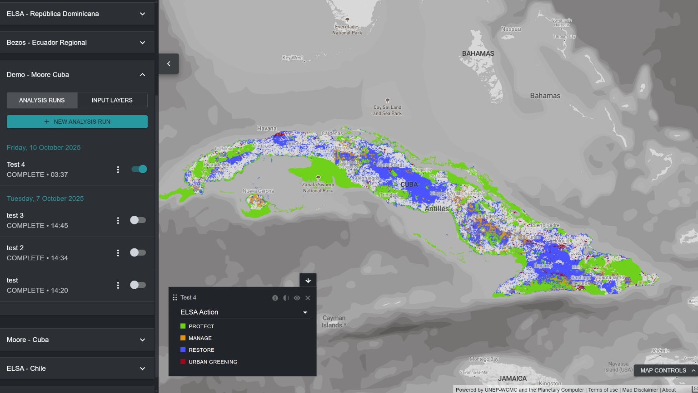

# Para que serve a ferramenta ELSA?

A Ferramenta ELSA permite que diversas partes interessadas avaliem de forma colaborativa as prioridades nacionais para o KMGBF, explorem compensações e sinergias, e desenvolvam planos espaciais para apoiar a implementação nacional dos Objetivos 1, 2 e 3. A Ferramenta ELSA produz mapas de priorização espacial que identificam áreas para proteção, restauração, gestão e reverdecimento urbano que terão o maior impacto para alcançar os Objetivos 1-12 do KMGBF. Os mapas de ações prioritárias ELSA resultantes podem também apoiar a implementação da hierarquia de resposta da Neutralidade da Degradação da Terra (LDN) no âmbito da Convenção das Nações Unidas de Combate à Desertificação (UNCCD). A hierarquia de resposta LDN é uma abordagem estruturada para alcançar a neutralidade, dando prioridade à prevenção, à minimização da degradação em curso e à restauração das terras degradadas. Os utilizadores com um [espaço de trabalho UNBL](https://unbiodiversitylab.org/en/unbl-workspaces/) podem utilizar a Ferramenta ELSA para executar uma priorização espacial nacional personalizada como parte de um processo participativo de planeamento espacial. Podem:

  - Mostrar camadas de entrada (também conhecidas como características de planeamento) utilizadas para mapear os objetivos do KMGBF.
  - Criar e executar novas execuções de análise ELSA com diferentes grupos de partes interessadas. Os utilizadores podem modificar e editar execuções de análise ELSA das seguintes formas:
    - Modificar a percentagem do território nacional atribuída a cada zona de ação baseada na natureza, incluindo proteção (Objetivo 3 do KMGBF), restauração (Objetivo 2 do KMGBF), gestão (Objetivo 10 do KMGBF) e/ou reverdecimento urbano (Objetivo 12 do KMGBF). Estas configurações podem ser adaptadas às metas políticas do país em matéria de conservação, restauração e proteção, entre outras;
    - Escolher se as Áreas Protegidas existentes devem ser bloqueadas para proteção, garantindo que as Áreas Protegidas existentes são selecionadas no mapa de solução;
    - Editar os pesos de cada uma das camadas de entrada (características de planeamento) com base na importância nacional da característica mapeada e na confiança nos dados de entrada; e
    - Editar o parâmetro do fator de penalização de fronteira para ajustar a coesão espacial do mapa de ação.
  - Visualizar e descarregar os mapas de calor e mapas de ação resultantes.
  - Descarregar os mapas de calor e mapas de ação resultantes em formato raster, que podem ser utilizados para análises adicionais, de acordo com as necessidades das partes interessadas, em software de Sistemas de Informação Geográfica (SIG) para computador.
  - Descarregar os resultados e parâmetros de uma execução de análise ELSA existente como uma tabela de resumo, disponível nos formatos .xlsx, .csv e .json.

A Ferramenta ELSA **não pode** ser utilizada para:

  - Adicionar camadas de dados adicionais para inclusão como características de planeamento ou como restrições de zonamento.
  - Substituir diretamente camadas de entrada por outras camadas de entrada.
  - Adicionar características de bloqueio adicionais.

Estas modificações, bem como o desenvolvimento de análises personalizadas adicionais para responder às necessidades nacionais, estão disponíveis junto da equipa UNBL mediante recuperação de custos. Para saber mais e explorar opções, contacte support@unbiodiversitylab.org.

A Ferramenta ELSA utiliza o pacote *prioritizr* no backend como ferramenta de otimização espacial para executar uma análise ELSA. O *prioritizr* suporta uma ampla gama de objetivos, restrições e penalizações para criar uma análise personalizada. As otimizações podem ser executadas rapidamente no UNBL (frequentemente em 3-5 minutos). Por isso, a ferramenta pode ser utilizada para gerar e aperfeiçoar planos de conservação em tempo real durante reuniões com as partes interessadas, e contribuir para um processo de tomada de decisão mais transparente, inclusivo e participativo para identificar áreas prioritárias que apoiem a implementação dos Objetivos 1, 2 e 3 do KMGBF, com importantes cobenefícios para os Objetivos 4-12.

!!! note
    As definições da terminologia técnica mencionada no guia encontram-se no [Anexo 1](12_annex1.md).

<figure markdown>

<figcaption>Figura 1. Interface inicial da Ferramenta ELSA no UNBL.</figcaption>
</figure>
