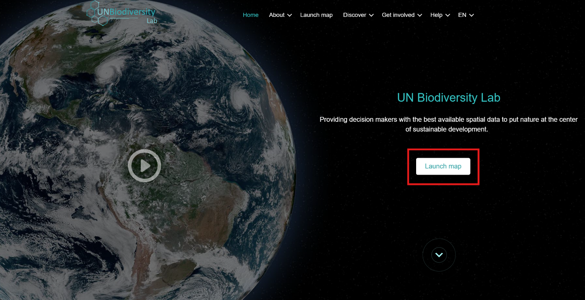
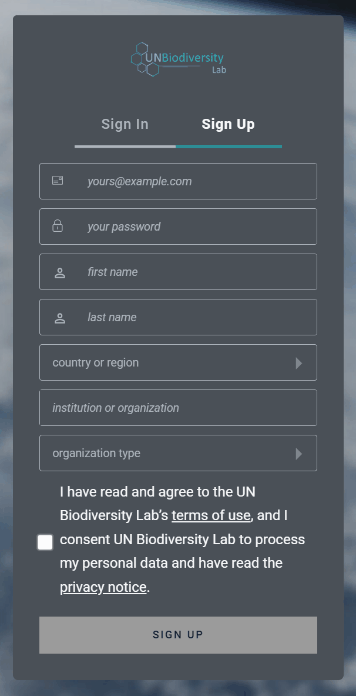
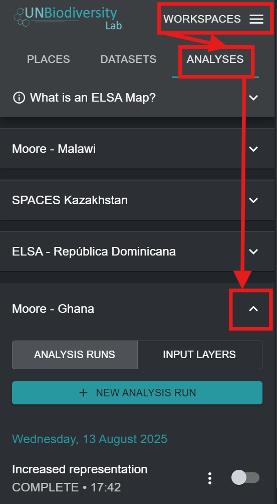

# Registar-se no UNBL e Solicitar Acesso a um Espaço de Trabalho com uma Configuração da Ferramenta ELSA

Para se registar no UNBL e solicitar acesso a um espaço de trabalho e à Ferramenta ELSA, siga os passos seguintes.

1. Clique no botão 'Launch map' no site do UN Biodiversity Lab para aceder à aplicação de dados.

	<figure markdown>
	
	<figcaption>Figura 2. Página inicial do UNBL</figcaption>
	</figure>

2. Depois de carregada, selecione o ícone de conta no canto superior direito e escolha 'sign up'. Introduza o seu e-mail, nome, país e instituição (opcional) e defina a sua palavra-passe para se registar.

	<figure markdown>
	
	<figcaption>Figura 3. Janela de registo</figcaption>
	</figure>

3. Receberá um e-mail dentro de alguns minutos. Siga as instruções desse e-mail para verificar a sua conta.
4. Depois de a sua conta ser verificada, pode iniciar sessão com o seu endereço de e-mail e palavra-passe sempre que aceder à plataforma.
5. Para utilizar a Ferramenta ELSA para o seu país, basta [solicitar um espaço de trabalho no UN Biodiversity Lab](https://unbiodiversitylab.org/en/unbl-workspaces/) através do nosso formulário e indicar que pretende ter acesso à Ferramenta ELSA. Para outras questões, não hesite em contactar-nos através de <support@unbiodiversitylab.org>.
6. Depois de o espaço de trabalho ser criado, receberá uma confirmação por e-mail. Poderá aceder-lhe navegando até à aplicação de mapas UNBL, ativando o espaço de trabalho no separador que aparece depois de clicar no separador 'WORKSPACES' no canto superior esquerdo e clicando em 'ANALYSES', depois de escolher o seu espaço de trabalho, para ver a Ferramenta ELSA. As configurações da Ferramenta ELSA podem ser criadas para um ou vários países dentro do seu espaço de trabalho.
7. Se tiver uma ou mais configurações de ferramenta num único espaço de trabalho, ou tiver acesso a vários espaços de trabalho com configurações de ferramenta, aparecerá uma lista das configurações de ferramenta disponíveis no separador depois de clicar em 'ANALYSES'. Clique na seta para baixo da configuração de ferramenta que pretende utilizar para a selecionar. Se tiver acesso a apenas uma configuração de ferramenta ou tiver apenas um espaço de trabalho com uma configuração de ferramenta ativada, essa configuração de ferramenta será selecionada automaticamente.

<figure markdown>

<figcaption>Figura 4. Aceder à configuração da Ferramenta ELSA para Moore – Gana</figcaption>
</figure>
