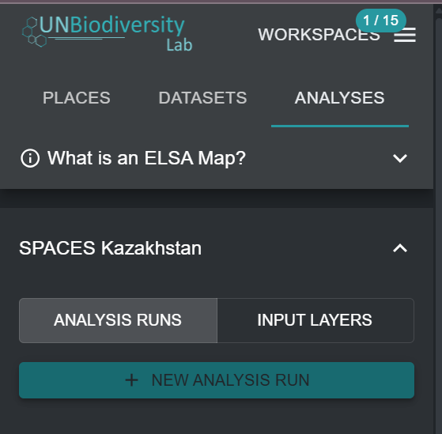

# Criar novas execuções de análise ELSA

Depois de selecionar uma Ferramenta ELSA específica no menu pendente da Figura 4, pode criar uma nova execução de análise. Para tal, clique no botão 'NEW ANALYSIS RUN'. Aparecerá uma janela pop-up com a estrutura de otimização ELSA padrão e todos os parâmetros ELSA relevantes prontos para edição (consulte a [Figura 5](#fig-create-new-analysis)).

!!! important
    Os utilizadores não podem criar nem editar configurações da Ferramenta ELSA. Podem apenas criar ou editar execuções de análise dentro de uma configuração da Ferramenta ELSA. Para solicitar uma configuração da Ferramenta ELSA para um país específico, contacte <support@unbiodiversitylab.org>.

<figure markdown>
{#fig-create-new-analysis}
<figcaption>Figura 5. Criar uma nova execução de análise</figcaption>
</figure>
