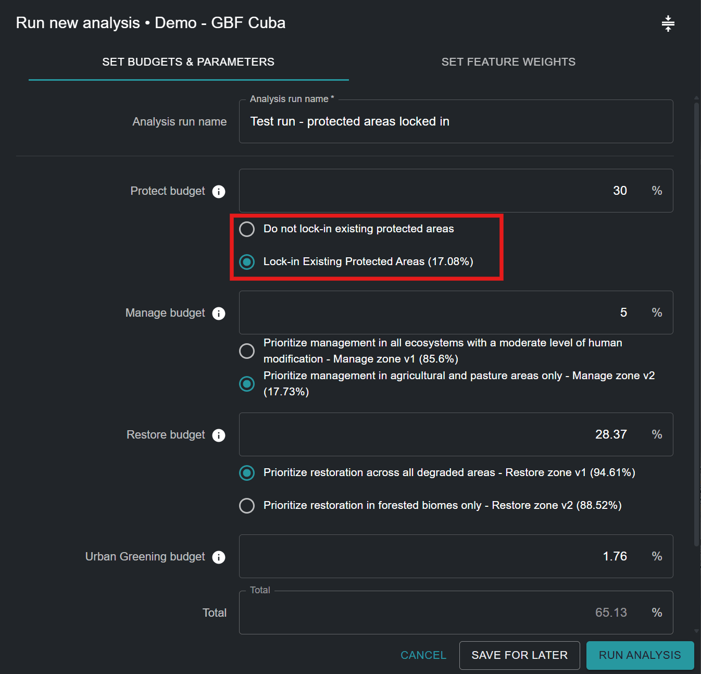
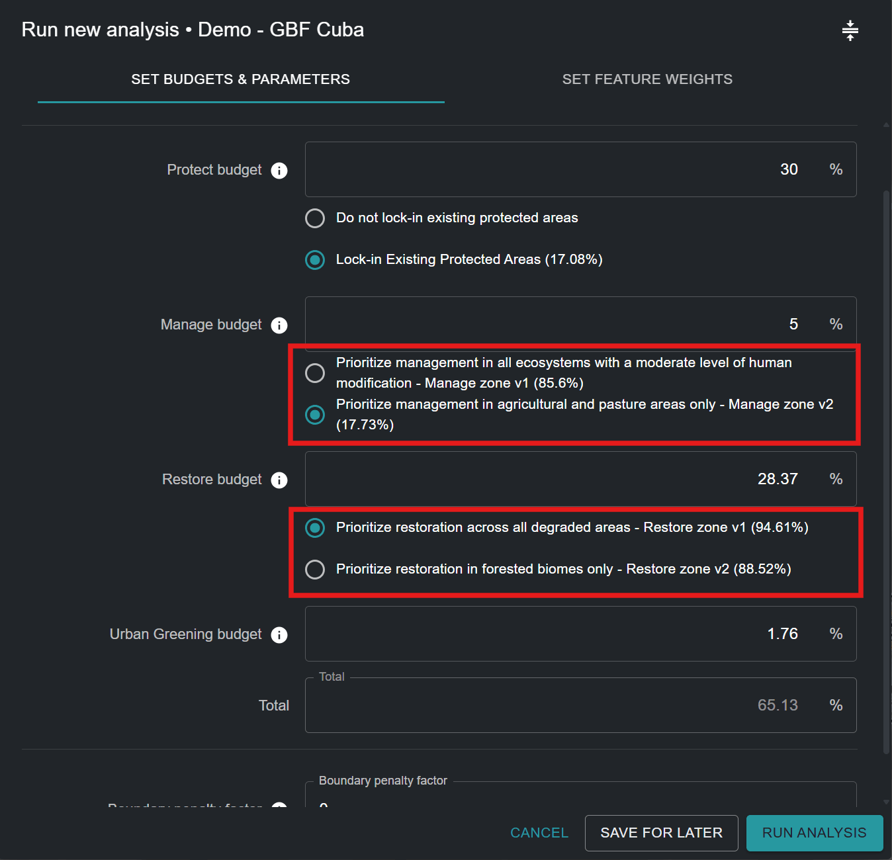
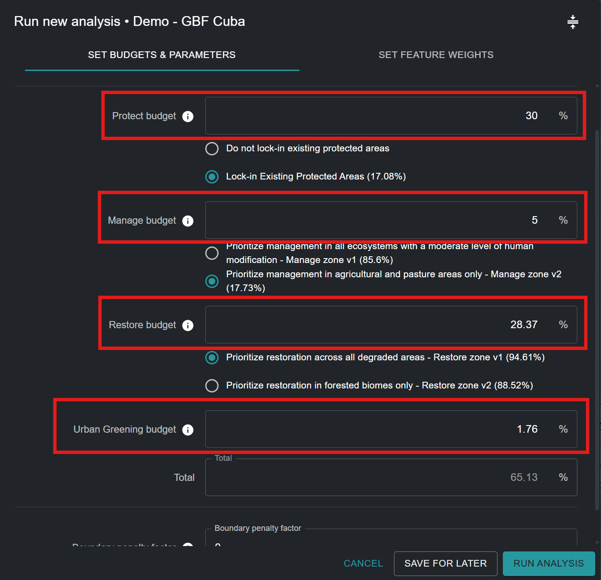
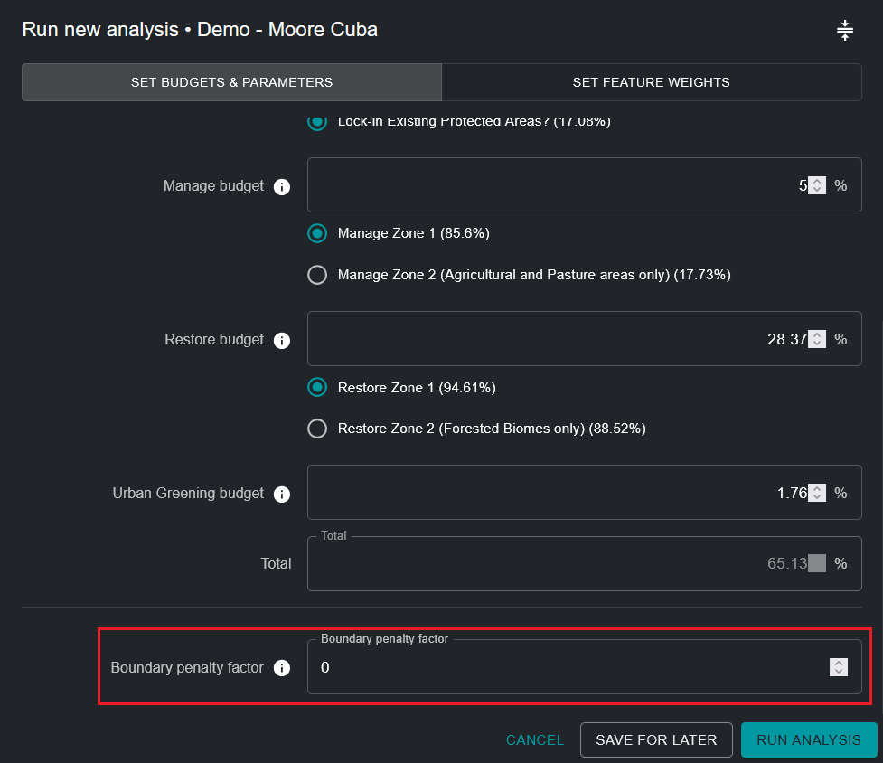
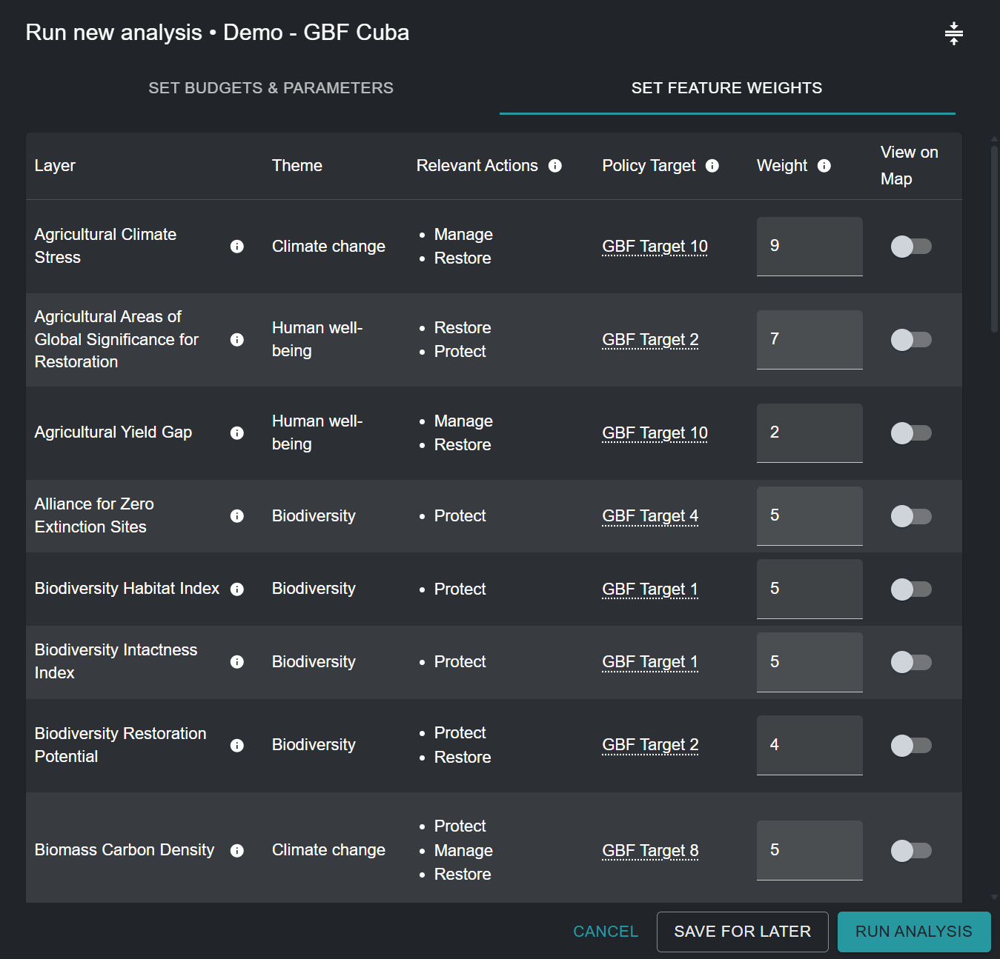
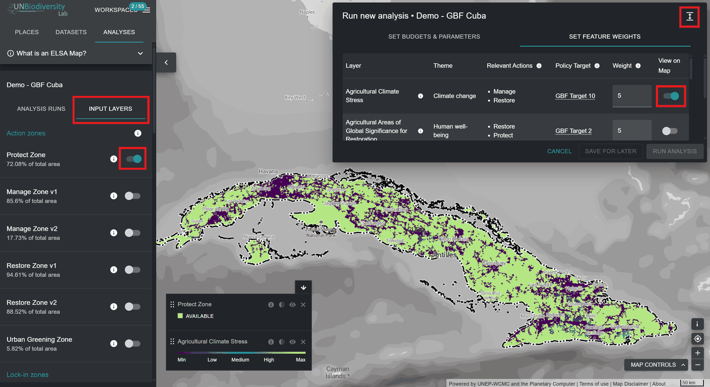
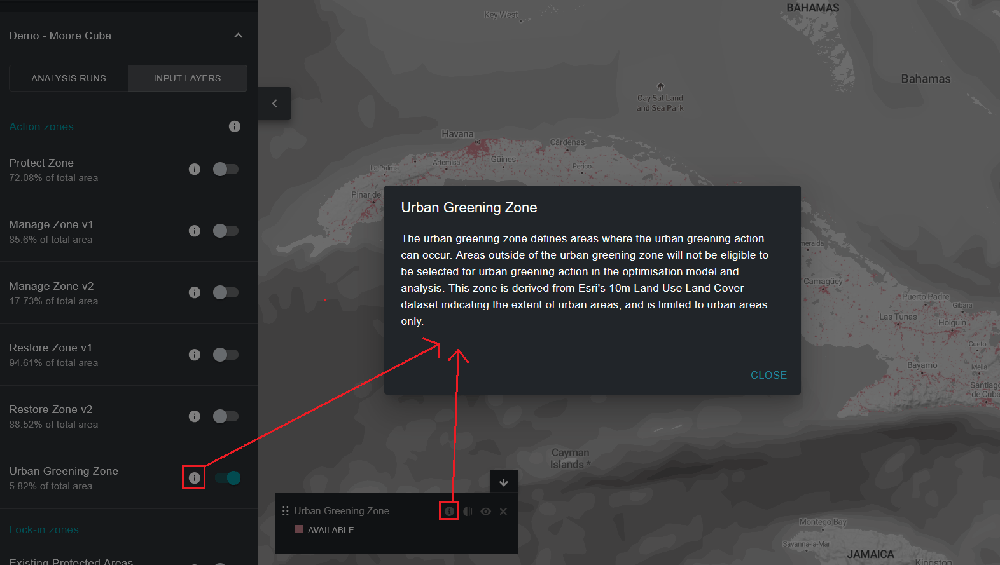

# Editar uma execução de análise ELSA

!!! info "Conceitos-Chave"
    * [Zonas de Ação](12_annex1.md#action-zones)
    * [Características de Bloqueio](12_annex1.md#lock-in-features)
    * [Meta baseada em área](12_annex1.md#area-based-target)
    * [Fator de Penalização de Fronteira (BPF)](12_annex1.md#boundary-penalty-factor-bpf)
    * [Característica de planeamento](12_annex1.md#planning-feature)
    * [Unidades de planeamento](12_annex1.md#planning-units)
    * [Software de apoio à decisão](12_annex1.md#decision-support-software)
    * [Sistema de Informação Geográfica (SIG)](12_annex1.md#geographic-information-system-gis)
    * [Restrições](12_annex1.md#restrictions)
    * [Representação](12_annex1.md#representation)
    * [Planeamento Sistemático da Conservação (SCP)](12_annex1.md#systematic-conservation-planning-scp)
    * [Interface do utilizador](12_annex1.md#user-interface)
    * [Pesos](12_annex1.md#weights)

## Nomear a execução de análise ELSA

Ao clicar em 'NEW ANALYSIS RUN' ([Figura 5](04_creating_analysis.md#fig-create-new-analysis)), poderá ver e editar uma análise provisória. Primeiro, deve atribuir um nome novo e único à sua execução de análise. Embora não existam restrições quanto ao nome dado a cada execução, sugerimos que os nomes das execuções incluam descrições significativas, idealmente com referência aos parâmetros utilizados (por exemplo, incluir informações como BPF 10 ou Proteger 38%).

## Selecionar funções de bloqueio

Pode garantir que determinadas áreas são incluídas no seu mapa de ação. Concetualmente, isto compreende-se mais facilmente como o bloqueio de áreas de planeamento existentes na ação de proteção num mapa, o que, no essencial, reproduz a realidade no terreno. Isto obriga a que estas áreas sejam selecionadas dentro da ação de proteção no mapa, e estas áreas passam obrigatoriamente a contribuir para o cumprimento da meta baseada em área para a proteção. A cobertura nacional de áreas protegidas (%) é apresentada entre parênteses. As configurações de ferramenta não se limitam ao bloqueio de áreas protegidas existentes na ação de proteção (por exemplo, pode ser desejável bloquear áreas de projetos de restauração existentes na ação de restauração); no entanto, por predefinição, as configurações de ferramenta estão atualmente preparadas apenas para permitir o bloqueio de áreas protegidas.

!!! important
    As Áreas Protegidas são bloqueadas **POR PREDEFINIÇÃO**

Bloqueio de Áreas Protegidas ([Figura 6](#fig-lockin-options)):

* Selecione 'Lock-in Existing Protected Areas' se pretender obrigar a análise a incluir as Áreas Protegidas existentes na ação de 'Proteção' da solução.
* Selecione 'Lock-in nothing' se pretender avaliar de forma independente a localização ideal das Áreas Protegidas existentes e novas no seu país, com base nas áreas de 'Proteção' selecionadas no mapa de ação resultante.

<figure markdown>
{#fig-lockin-options}
<figcaption>Figura 6. Funcionalidades de bloqueio</figcaption>
</figure>

Como se pode ver na [Figura 6](#fig-lockin-options) para Cuba, as Áreas Protegidas existentes cobrem 17,08% do país. Por isso, a seleção de 'Lock-in Existing Protected Areas' exige que pelo menos 17,08% do território nacional seja atribuído à meta baseada em área de 'Proteção'.

## Zonas Alternativas

Os utilizadores não podem definir zonas por si próprios, mas, para algumas ações, pode existir uma zona predefinida e uma zona alternativa que pode ser selecionada. Por exemplo, algumas ferramentas podem ter uma opção para considerar "Apenas áreas agrícolas" para a ação de gestão, ou "Apenas áreas florestais" para a ação de restauração, com base nas necessidades e prioridades individuais dos utilizadores e dos países.

<figure markdown>
{#fig-alt-zone-options}
<figcaption>Figura 7. Zonas alternativas para delimitar as áreas de atividade baseadas na natureza</figcaption>
</figure>

## Definir metas baseadas em área para as ações

Esta parte da ferramenta permite definir metas baseadas em área (metas) para a proteção, a restauração, a gestão e/ou o reverdecimento urbano. As metas baseadas em área também podem ser entendidas como a percentagem da área terrestre que deve ser atribuída a cada ação no mapa de ação resultante. Os valores predefinidos em qualquer Ferramenta ELSA derivam das metas terrestres do KMGBF, a menos que tenham sido personalizados para o seu país pela equipa UNBL com base na sua Estratégia e Plano de Ação Nacional para a Biodiversidade (NBSAP) ou noutros documentos de política nacional.

!!! warning "Tenha em conta os diferentes tipos de ações disponíveis na Ferramenta ELSA e as políticas que lhes estão associadas:"
	| Ação predefinida | Objetivo do KMGBF | Hierarquia de resposta LDN da UNCCD |
	|----------------|--------------|------------------------------|
	| Proteger | Objetivo 3 | Evitar |
	| Restaurar | Objetivo 2 | Reverter |
	| Gerir | Objetivo 10 | Reduzir |
	| Reverdecimento Urbano | Objetivo 12 | N/A |
	
	As ações aqui referidas são o equivalente funcional das ações da hierarquia de resposta LDN apoiada no âmbito da UNCCD. 'Proteger' equivale a 'evitar' a degradação da terra, 'gerir' equivale a 'reduzir' a degradação da terra e 'restaurar' equivale a 'reverter' a degradação da terra. Em resumo, isto faz corresponder "Proteger–Gerir–Restaurar" a "Evitar–Reduzir–Reverter", garantindo o alinhamento entre os quadros globais de biodiversidade. Para mais informações sobre cada Objetivo do KMGBF, consulte o [site da CDB](https://www.cbd.int/gbf/targets). Para mais informações sobre a hierarquia de resposta LDN, consulte o [site da UNCCD](https://www.unccd.int/land-and-life/land-degradation-neutrality/overview).

Pode definir qualquer valor maior ou igual a 0,001 para os objetivos de proteção, restauração, gestão e/ou reverdecimento urbano. A soma dos valores de todos os objetivos pode ser menor ou igual a 100%, mas não deve exceder 100%. Além disso, o valor máximo de qualquer meta baseada em área não pode exceder a área total dessa zona de ação. Por exemplo, se 80% de um país estiver coberto por uma zona de proteção, o valor máximo que pode ser atribuído à meta baseada em área para a proteção não pode exceder 80%. Se introduzir um número demasiado elevado, receberá um erro que indica o valor máximo que pode ser atribuído.

!!! note
    Nota: A localização e a área total de cada zona de ação definem onde é possível que cada ação ocorra. São determinadas com base no tipo de ecossistema e no nível de desenvolvimento de um país (por exemplo, a proteção não pode ocorrer em áreas com um índice industrial humano elevado).

Deve também ter em conta que, se pretender bloquear as Áreas Protegidas existentes (a predefinição), a meta global baseada em área para a proteção deve ser igual ou superior à área terrestre coberta pelas Áreas Protegidas existentes. Por exemplo, a área terrestre coberta pelas Áreas Protegidas existentes em Cuba é de 17,08%. Por isso, a meta baseada em área para a proteção deve ser igual ou superior a 17,08%.

<figure markdown>
{#fig-setting-objectives}
<figcaption>Figura 8. Definir objetivos</figcaption>
</figure>

## Especificar o fator de penalização de fronteira

O fator de penalização de fronteira é utilizado para promover a coesão espacial ao dar prioridade às zonas de uso do solo. A penalização de fronteira pode ser 0 ou superior. Quanto maior o valor, mais ligadas e contíguas serão as zonas de ação no mapa. Este ajuste baseia-se na ideia de que, no planeamento real, uma zona mais ligada é geralmente mais fácil de gerir e de nela executar ações.

Passos:

1. Para definir a penalização de fronteira, comece com um número pequeno, por exemplo, 10.
2. Aumente o número de forma iterativa, ou seja, voltando a executar a análise repetidamente, por ordens de grandeza (por exemplo, 10 -> 100-> 1000), reduzindo o ritmo de aumento à medida que se aproxima de soluções que conduzem ao nível de agrupamento pretendido. Sempre que alterar a penalização, terá de voltar a executar a otimização até chegar a um mapa suficientemente contíguo para responder às suas necessidades.

!!! attention
    Aumentar o fator de penalização de fronteira a partir de 0 resultará em tempos de resolução mais longos; em alguns casos, estes podem ser muito mais longos.

<figure markdown>
{#fig-adjust-bpf}
<figcaption>Figura 9. Ajuste do fator de penalização de fronteira</figcaption>
</figure>

## Editar os pesos das características de planeamento

Para editar os pesos das características de planeamento, clique no botão 'SET FEATURE WEIGHTS' junto ao canto superior direito da janela pop-up da execução de análise.

Deve introduzir um peso para cada característica de planeamento da lista de dados de entrada. Recomendamos uma escala de 0 a 10, da seguinte forma, com base no nível de prioridade de cada característica de planeamento e na sua confiança na exatidão do conjunto de dados para o seu país:

* 0 - não importante / excluído da análise
* 1,0 - baixa importância / importância inferior à média
* 5,0 - importância média
* 10 - máxima importância

Para permitir que os utilizadores tomem a decisão mais informada possível, o tema (biodiversidade/alterações climáticas/bem-estar humano), as ações relevantes e a meta política do KMGBF que serve de referência (ou outra meta relevante da NBSAP/política nacional) são indicados para cada característica de planeamento. Pode avaliar o nível de prioridade de cada característica de planeamento e atribuir um peso informado, decidindo sobre a importância relativa de cada uma das características de planeamento utilizadas para mapear os objetivos do KMGBF (ou outras metas relevantes da NBSAP/política nacional definidas pelo seu país) no seu país. Por exemplo, se o Objetivo 1 do KMGBF for de especial importância para o seu país, características de planeamento como o índice de habitat da biodiversidade e o índice de integridade da biodiversidade devem receber um peso maior (> 3). Em alternativa, se considerar que os ecossistemas ameaçados no seu país estão particularmente degradados e devem ser tidos em conta na identificação de áreas prioritárias para restauração no âmbito do Objetivo 2 do KMGBF, pode atribuir um peso maior à característica de planeamento 'Ecossistemas Ameaçados para Restauração', que mapeia especificamente essas áreas.

Para uma lista completa dos dados de entrada, bem como dos objetivos do KMGBF que servem para mapear, consulte o [Anexo 2](13_annex2.md).

<figure markdown>
{#fig-edit-weights}
<figcaption>Figura 10. Editar pesos</figcaption>
</figure>

## Visualizar camadas de entrada

Se pretender visualizar as características de planeamento antes de definir os pesos, pode:

- Minimizar e arrastar a janela pop-up e selecionar as camadas que pretende visualizar, clicando no botão de alternância da coluna *View on Map*

- Sair da janela pop-up clicando em 'SAVE FOR LATER' no canto inferior direito (pode regressar ao rascunho guardado da sua execução de análise depois de visualizar as características de planeamento pretendidas) e, em seguida, clicar na opção 'INPUT LAYERS', ao lado da opção 'ANALYSIS RUNS', no separador de ferramentas à esquerda. Clique no botão de alternância para visualizar camadas específicas.

<figure markdown>

<figcaption>Figura 11. Visualizar zonas de ação e características de planeamento no UNBL</figcaption>
</figure>

Cada camada individual de característica de planeamento de entrada incluída na análise ELSA foi especificamente adaptada para ajudar a identificar áreas prioritárias para a implementação do KMGBF, bem como para a implementação da NBSAP/outra política nacional, se tal for especificamente solicitado pelo seu país. Se visualizar as camadas através da lista 'INPUT LAYERS' no separador de ferramentas à esquerda, pode também visualizar características de bloqueio (opcionais), nomeadamente as áreas protegidas existentes no seu país, bem como a camada de cada zona de ação que define onde é possível que cada ação ocorra no seu país para a análise.

Em resumo:

* Clique no botão de alternância de cada zona de ação/zona de bloqueio/camada de característica de planeamento de entrada que pretende apresentar.
* Clique novamente no botão de alternância para retirar a camada selecionada da visualização.
* Tem a opção de visualizar informações adicionais (descrição da camada, camadas de entrada originais, fonte) sobre as camadas atualmente ativadas, clicando no ícone redondo '**i**', quer na legenda da camada individual, quer ao lado do botão de alternância de cada camada.

<figure markdown>

<figcaption>Figura 12. Visualizar metadados</figcaption>
</figure>
