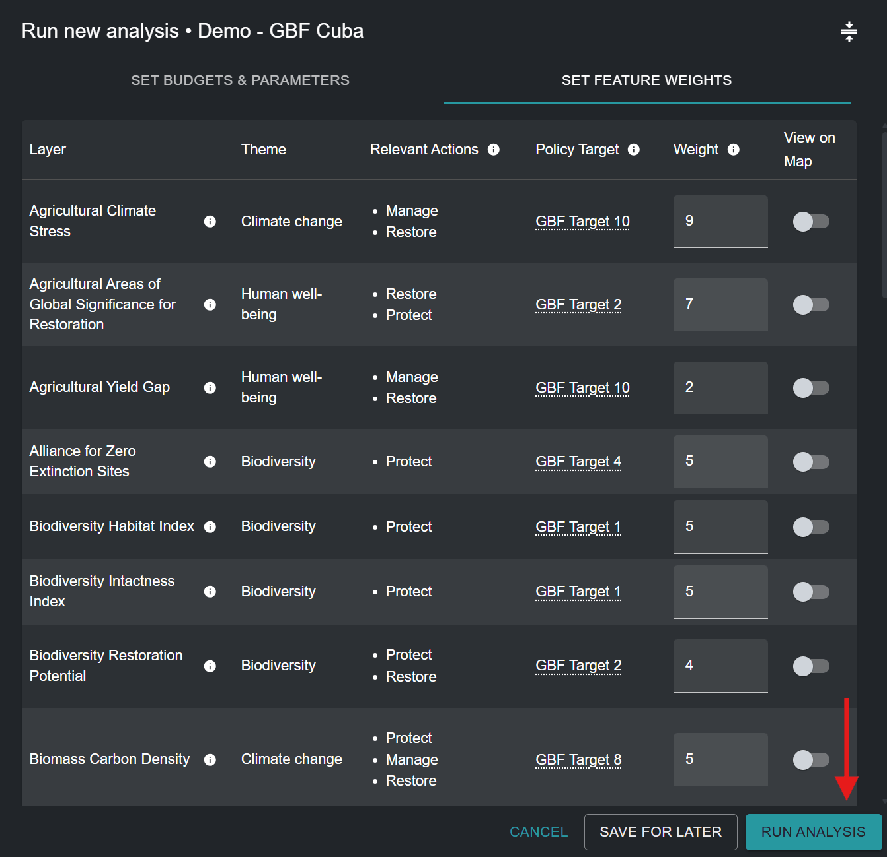
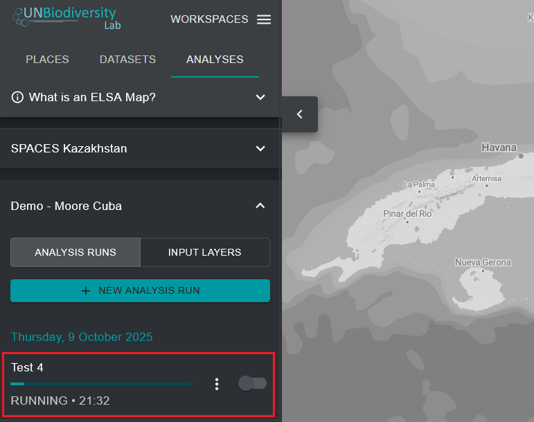

# Executar a otimização

Para criar um mapa de ação ELSA que mostre as áreas prioritárias para a implementação dos Objetivos 1-12 do KMGBF, a otimização executada pela ferramenta segue três regras fixas:

* Não deve exceder as metas baseadas em área selecionadas;
* Deve incluir as áreas de bloqueio selecionadas; e
* Deve incluir as áreas que melhor representam as características de planeamento com base na sua distribuição espacial e ponderação.

Depois de nomear a sua execução de análise, definir as metas baseadas em área, as funcionalidades de bloqueio e um fator de penalização de fronteira, e editar os pesos das características de planeamento, a execução de análise está pronta para ser executada. Para tal, clique no botão azul 'RUN ANALYSIS' no canto inferior direito da janela pop-up da execução de análise. Tenha em atenção que este botão só ficará disponível para clicar e executar depois de todos os parâmetros relevantes terem sido preenchidos.

<figure markdown>

<figcaption>Figura 13. Executar a análise</figcaption>
</figure>

A execução da análise pode demorar entre um e cinco minutos. No entanto, se o país for grande, se estiverem a ser utilizadas muitas características de planeamento ou se for aplicado um fator de penalização de fronteira elevado, poderá demorar muito mais tempo. Verá uma barra de progresso que indica o estado da análise. Desaconselhamos a execução de uma segunda análise ELSA antes de a primeira análise estar concluída. Depois de a barra de progresso atingir 100% e a análise ter sido executada, pode ver o resultado da sua análise como a entrada mais recente no separador esquerdo, em 'ANALYSIS RUNS'.

## Próximos Passos

Os capítulos seguintes explicam em pormenor como visualizar, avaliar e analisar os resultados da sua análise ELSA. Se pretender alterar os parâmetros da sua análise e efetuar uma nova execução depois de avaliar os resultados, pode duplicar uma execução anterior, editá-la e criar uma nova versão.

<figure markdown>

<figcaption>Figura 14. Execução de análise ELSA em tempo real</figcaption>
</figure>
