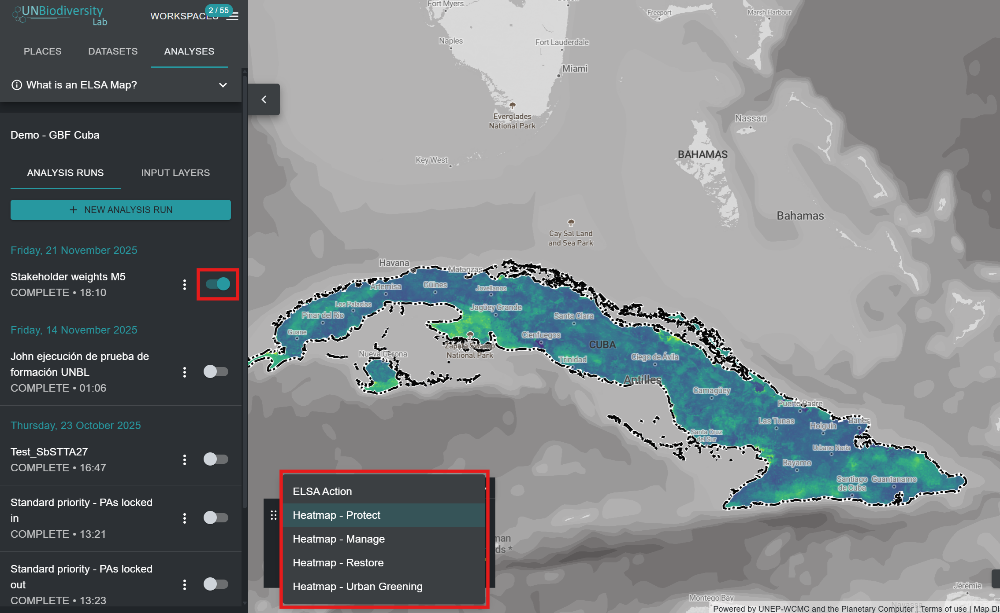
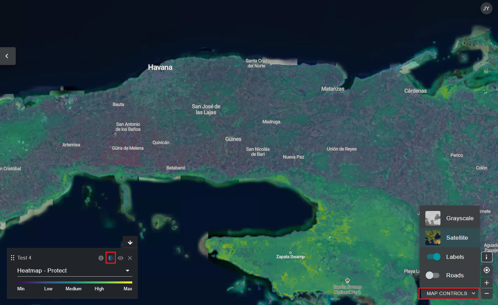

# Visualizar mapas de calor

Depois de executar uma análise ELSA, poderá ver os resultados clicando no botão de alternância no separador esquerdo. No menu pendente da legenda que aparece no mapa, pode escolher entre visualizar o mapa de ação final ou as camadas de mapa de calor. Sugerimos que visualize primeiro os mapas de calor.

<figure markdown>
{#fig-viewing-hm}
<figcaption>Figura 15. Visualizar camadas de mapa de calor</figcaption>
</figure>

Os mapas de calor identificam localizações importantes para alcançar os Objetivos 1-12 do KMGBF, ou outras metas políticas especificadas pelo seu país. Correspondem à soma normalizada dos valores das características de planeamento em cada unidade de planeamento, tendo em conta os pesos atribuídos pelo utilizador a cada característica de planeamento. As áreas importantes (onde ocorrem mais características de planeamento, ajustadas pela ponderação) são apresentadas numa gama de cores do verde ao amarelo, sendo as de amarelo vivo as mais importantes. Os mapas de calor podem ser utilizados para identificar áreas onde a contribuição global das características de planeamento para os Objetivos 1-12 do KMGBF é maior.

Ao avaliar os mapas de calor, os especialistas em dados podem visualizar os dados agregados das características de planeamento, ponderados pelo utilizador, para determinar se os padrões correspondem às suas expectativas e ao seu conhecimento pessoal da região. Para ajudar neste processo, os utilizadores podem alternar entre os mapas de calor e as imagens de satélite subjacentes/mapas rodoviários/mapas de características de planeamento, o que ajuda a situar os mapas de calor na paisagem e a identificar que características de planeamento estão a contribuir especificamente para as áreas de grande importância para os objetivos do KMGBF.

!!! important
    Para ativar as imagens de satélite e as estradas, os utilizadores devem clicar no botão 'MAP CONTROLS' no canto inferior direito da aplicação de dados UNBL. Em seguida, podem clicar no ícone do olho na caixa da legenda para ocultar o mapa de calor e ver as imagens de satélite, ou no botão de opacidade à esquerda do ícone do olho para reduzir a opacidade do mapa de calor e ver ao mesmo tempo as imagens de satélite subjacentes e o mapa de calor.

<figure markdown>
{#fig-eval-hm}
<figcaption>Figura 16. Avaliar mapas de calor</figcaption>
</figure>
