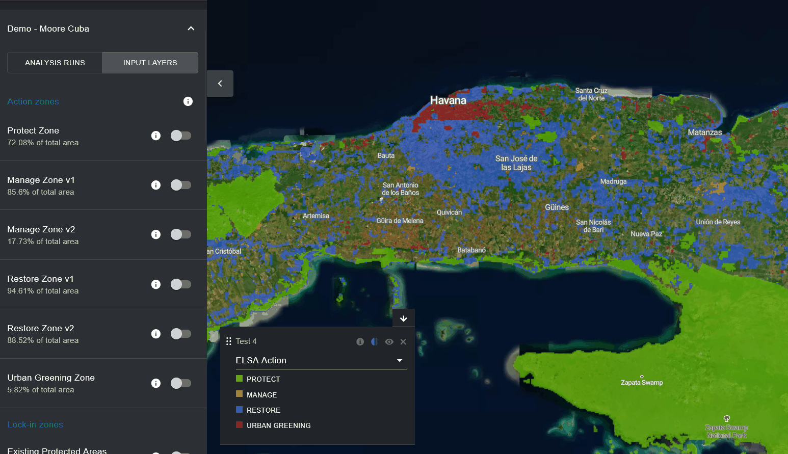
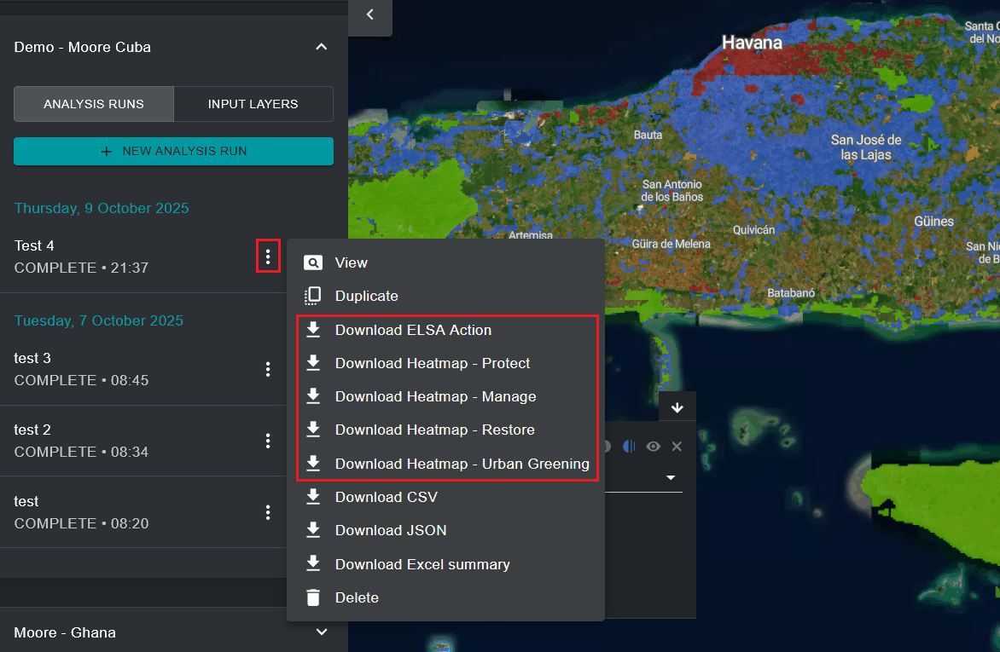

# Affichage et téléchargement des cartes d'action

Après avoir effectué une analyse ELSA, vous pouvez afficher la carte d'action finale associée à cette version de l'analyse en basculant l'analyse dans l'onglet de gauche. La couche « ELSA Action » qui s'affiche par défaut sur la carte est la carte d'action finale qui indique les zones prioritaires pour les actions de protection, de restauration, de gestion, et/ou de verdissement urbain dans votre pays qui peuvent le mieux contribuer à la réalisation des cibles 1 à 12 du KMGBF, ainsi que soutenir la mise en œuvre de la hiérarchie des mesures de neutralité en matière de dégradation des terres (LDN) dans le cadre de la Convention des Nations Unies sur la lutte contre la désertification (CLUND). La hiérarchie des mesures de neutralité en matière de dégradation des terres est une approche structurée visant à atteindre la neutralité en donnant la priorité à la prévention, en minimisant la dégradation continue, et en restaurant les terres dégradées. 

Comme pour les cartes de chaleur, les utilisateurs peuvent zoomer sur des zones spécifiques à l'aide de l'interface UNBL et basculer entre les images satellite et les autres couches disponibles dans l'espace de travail/la plateforme publique UNBL afin d'évaluer les résultats finaux.

<figure markdown>

<figcaption>Figure 17. Carte d'action ELSA indiquant les zones prioritaires pour la protection, la gestion, la restauration et le verdissement urbain autour de La Havane</figcaption>
</figure>

Les utilisateurs peuvent également télécharger les cartes d'action et les cartes de chaleur obtenues au format raster pour les utiliser dans un logiciel SIG externe.

<figure markdown>

<figcaption>Figure 18. Téléchargement des cartes d'analyse obtenues</figcaption>
</figure>

Le même menu propose également l'option **« Download ELSA log »** (Télécharger le journal ELSA). Le journal est un fichier contenant les messages produits par l'outil ELSA et par le solveur d'optimisation Gurobi pendant l'exécution de l'analyse. Il est utile en cas de problème : si une analyse échoue, dure anormalement longtemps ou donne des résultats inattendus, consultez le journal pour y repérer les avertissements ou les erreurs, et joignez-le lorsque vous contactez <support@unbiodiversitylab.org>.
