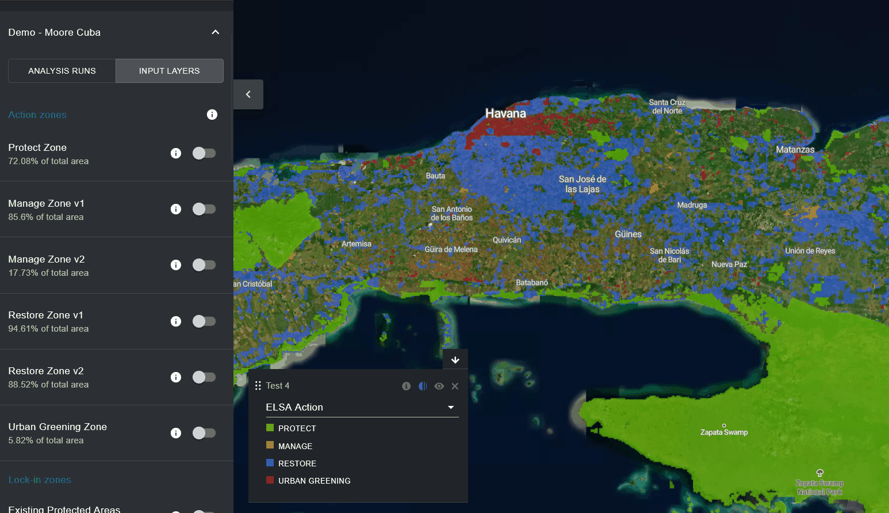
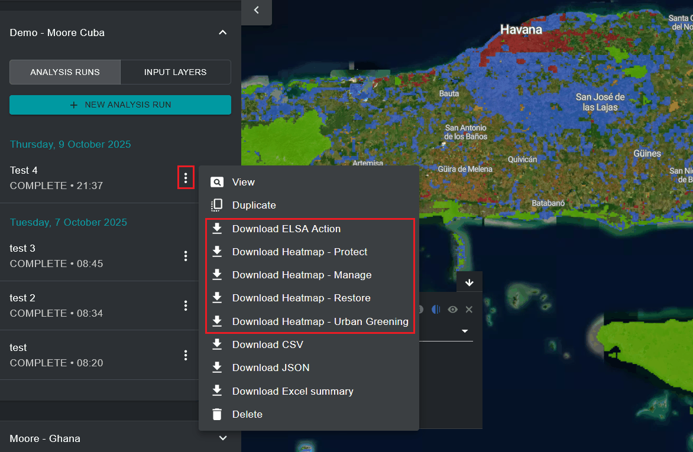

# Visualizar e descarregar mapas de ação ELSA

Depois de executar uma análise ELSA, pode ver o mapa de ação final associado a essa versão da análise clicando no botão de alternância da execução de análise no separador esquerdo. A camada 'ELSA Action' resultante, que aparece no mapa por predefinição, é o mapa de ação final que mostra as áreas prioritárias para ações de proteção, restauração, gestão e/ou reverdecimento urbano no seu país que melhor podem contribuir para os resultados dos Objetivos 1-12 do KMGBF, bem como apoiar a implementação da hierarquia de resposta da Neutralidade da Degradação da Terra (LDN) no âmbito da Convenção das Nações Unidas de Combate à Desertificação (UNCCD). A hierarquia de resposta LDN é uma abordagem estruturada para alcançar a neutralidade, dando prioridade à prevenção, à minimização da degradação em curso e à restauração das terras degradadas.

Tal como nos mapas de calor, os utilizadores podem ampliar áreas específicas através da interface do UNBL e ativar as imagens de satélite, bem como outras camadas disponíveis no espaço de trabalho/plataforma pública UNBL, para avaliar os resultados finais.

<figure markdown>

<figcaption>Figura 17. Mapa de ação que mostra as áreas prioritárias para proteção e restauração em torno de Havana</figcaption>
</figure>

Os utilizadores podem também descarregar os mapas de ação e os mapas de calor resultantes em formato raster para utilização externa em software SIG para computador.

<figure markdown>

<figcaption>Figura 18. Descarregar os mapas de análise resultantes</figcaption>
</figure>

O mesmo menu oferece também a opção **'Download ELSA log'** (Descarregar o registo do ELSA). O registo é um ficheiro com as mensagens produzidas pela ferramenta ELSA e pelo solucionador de otimização Gurobi durante a execução da análise. É útil para resolver problemas: se uma análise falhar, demorar mais do que o habitual ou produzir resultados inesperados, consulte o registo para encontrar avisos ou erros e anexe-o quando contactar <support@unbiodiversitylab.org>.
