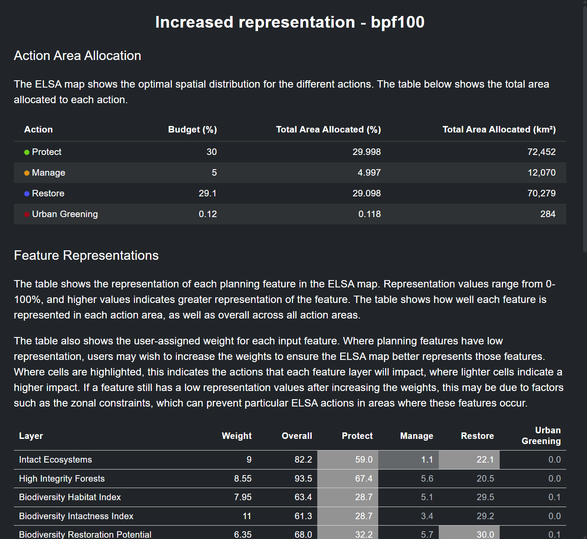
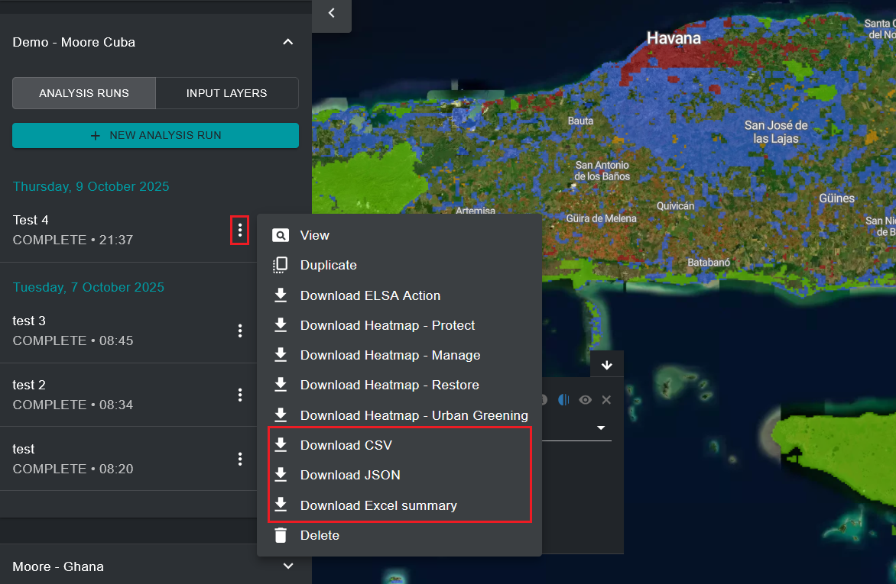

# Analisar sinergias e compensações

Um dos resultados da análise ELSA é a identificação de sinergias entre ações para os Objetivos do KMGBF que abrangem a biodiversidade, as alterações climáticas e o bem-estar humano. A análise mede o resultado de cada característica de planeamento com uma pontuação de representação, para mostrar onde o planeamento simultâneo para todos os objetivos do KMGBF pode ter levado a que características de planeamento específicas fiquem representadas a um nível inferior ao de outras características. Onde, nos mapas temáticos:

$$
\text{Pontuação de representação} = \frac{\text{Representação no mapa de ação ELSA}}{\text{Representação máxima}}
$$

Depois de executar uma análise, pode ver os resultados e avaliar se os parâmetros selecionados conduziram a uma representação aceitável de cada uma das características de planeamento.

Pode rever a representação das características de planeamento clicando no ícone {style="display: inline; height: 2em; width: 2em;"} na legenda da camada da execução de análise ativada. Será apresentada uma janela de informações de teste com a área terrestre total atribuída a cada ação baseada na natureza na análise, bem como uma tabela que mostra, para cada característica de planeamento, o peso, a representação global e a representação individual em cada ação baseada na natureza.

<figure markdown>

<figcaption>Figura 19. Caixa de informações sobre a representação das características</figcaption>
</figure>

Em alternativa, pode guardar estas mesmas informações no seu computador local clicando no botão {style="display: inline; height: 2em; width: 2em; transform: rotate(90deg);"} ao lado da entrada da sua execução de análise e, em seguida, clicando em 'Download CSV' ou 'Download JSON', consoante o formato pretendido. Pode também clicar em 'Download Excel summary' para descarregar uma folha de informações de teste mais completa, que mostra descrições dos dados e metadados de cada característica de planeamento, descrições das metas políticas utilizadas na análise e recursos de análise ELSA, juntamente com as pontuações de representação.

<figure markdown>

<figcaption>Figura 20. Descarregar as tabelas de resumo da representação das características</figcaption>
</figure>

Pode avaliar as pontuações de representação das características de planeamento à sua escolha e, de forma iterativa, duplicar e executar execuções de análise adicionais com pesos aumentados/diminuídos para as características de planeamento, consoante pretenda aumentar/diminuir a sua representação no mapa ELSA final.
