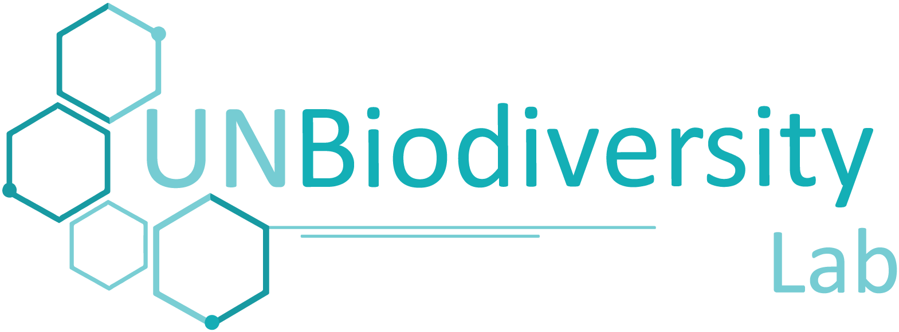

# Добро пожаловать в Руководство пользователя для UN Biodiversity Lab

Данное руководство пользователя было разработано для того, чтобы ознакомить вас с основными инструментами и функциями UN Biodiversity Lab. Нажмите на ссылки ниже, чтобы найти визуальные руководства по нашей **публичной платформе**, **рабочим пространствам** и **Инструменту интегрированного пространственного планирования ELSA**.

Если у вас есть дополнительные вопросы, пожалуйста, свяжитесь с нами по адресу <support@unbiodiversitylab.org>.

-   [:earth_africa: **Руководство пользователя публичной платформы UNBL**](unbl-public-platform/index.md)

-   [:gear: **Руководство пользователя рабочих пространств UNBL**](unbl-workspaces/index.md)

-   [:rocket: **Руководство пользователя инструмента интегрированного пространственного планирования ELSA**](elsa/index.md)

  
  
  
  

