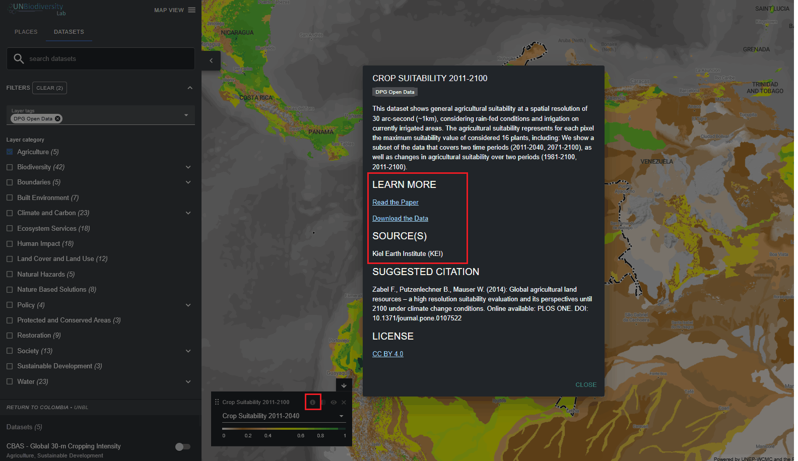

# Como posso encontrar mais informações sobre cada conjunto de dados?

  
▶️ Prefere vídeo? Clique aqui!

  

    <iframe
      src="https://www.youtube-nocookie.com/embed/7ZKjv79XlEM"
      title="UNBL tutorial"
      frameborder="0"
      allow="accelerometer; clipboard-write; encrypted-media; gyroscope; picture-in-picture; web-share"
      allowfullscreen>
    </iframe>
  

1.	Selecione o conjunto de dados e carregue-o no mapa.

2.	No canto inferior esquerdo da visualização do mapa, haverá uma legenda que mostra o nome e a simbologia de todos os conjuntos de dados atualmente ativados no mapa. Clique no ícone {style="display: inline; width: 1em; height: 2em; width: 2em;"} para visualizar as informações do conjunto de dados. Em alternativa, clique no mesmo ícone {style="display: inline; width: 1em; height: 2em; width: 2em;"} diretamente ao lado do botão de ativação de cada conjunto de dados no separador de pesquisa de conjuntos de dados. As informações fornecem uma descrição do conjunto de dados, a organização de origem, as citações e ligações para descarregar os dados.

