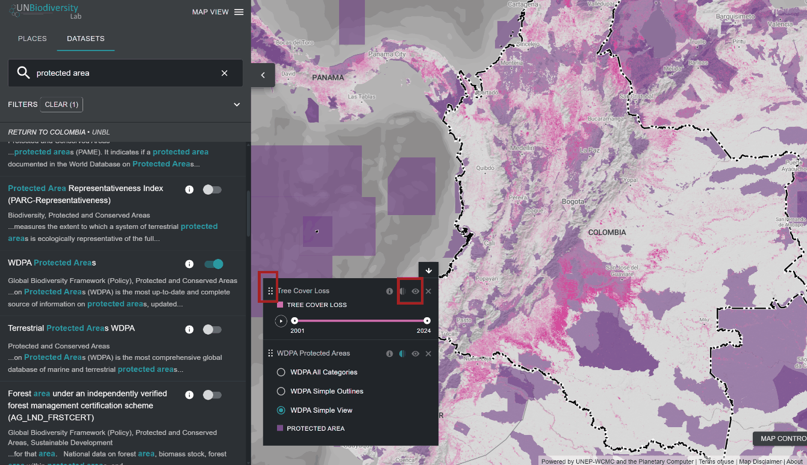

# Como posso personalizar as visualizações dos conjuntos de dados?

Ao selecionar vários conjuntos de dados, pode personalizar o mapa ajustando a sua ordem de sobreposição e opacidade.

  
▶️ Prefere vídeo? Clique aqui!

  

    <iframe
      src="https://www.youtube-nocookie.com/embed/4ZoGlPEWIOU"
      title="UNBL tutorial"
      frameborder="0"
      allow="accelerometer; clipboard-write; encrypted-media; gyroscope; picture-in-picture; web-share"
      allowfullscreen>
    </iframe>
  

1. Para alterar a ordem de sobreposição, clique e mantenha premido o ícone {style="display: inline; height: 2em; width: 2em;"} à esquerda do nome do conjunto de dados na legenda e mova o conjunto de dados para cima ou para baixo de acordo com a ordem de sobreposição preferida. O conjunto de dados no topo da legenda será o conjunto de dados no topo do mapa.

2. Para alterar a opacidade, clique no ícone {style="display: inline; height: 2em; width: 2em;"}. Reduzir a opacidade aumenta a transparência do conjunto de dados. Por exemplo, para visualizar tanto a perda de coberto arbóreo como as áreas protegidas, pode posicionar o conjunto de dados de perda de coberto arbóreo acima do conjunto de dados de áreas protegidas e ajustar a opacidade das áreas protegidas para 60%. Isto cria um mapa que mostra a perda de coberto arbóreo dentro das áreas protegidas, bem como a perda total em todo o país.

3. Para ocultar temporariamente um conjunto de dados no mapa, clique no ícone {style="display: inline; height: 2em; width: 2em;"}. Para o tornar novamente visível, clique no ícone {style="display: inline; height: 2em; width: 2em;"}.

