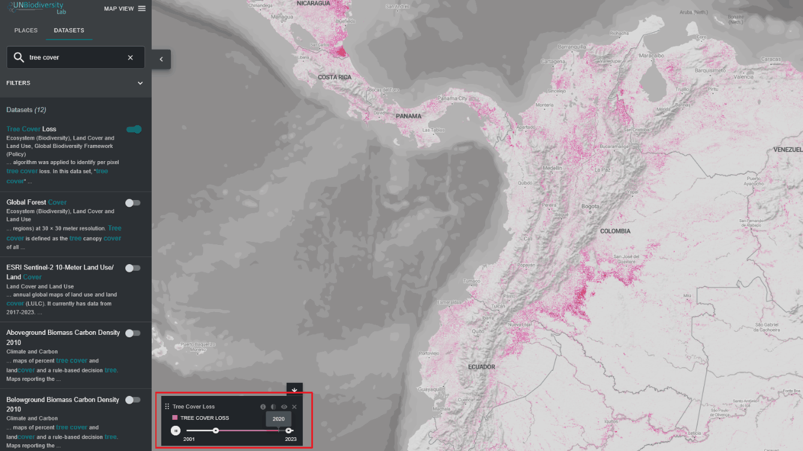
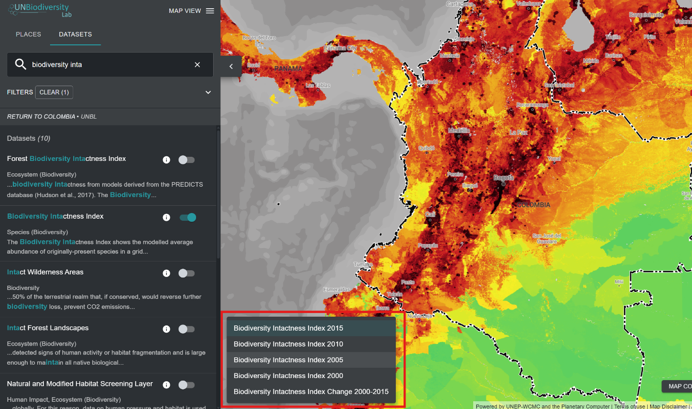

# Que opções tenho para visualizar conjuntos de dados de séries temporais?

O UN Biodiversity Lab dá-lhe acesso a conjuntos de dados que mostram alterações ao longo do tempo. Alguns conjuntos de dados de séries temporais são visualizados ao longo de vários anos com animação, outros podem ser visualizados por ano específico através do menu suspenso, e alguns são uma combinação de ambos, com a possibilidade de visualizar animações de anos específicos que podem ser escolhidos no menu suspenso.

  
▶️ Prefere vídeo? Clique aqui!

  

    <iframe
      src="https://www.youtube-nocookie.com/embed/Dz-nwotouBM"
      title="UNBL tutorial"
      frameborder="0"
      allow="accelerometer; clipboard-write; encrypted-media; gyroscope; picture-in-picture; web-share"
      allowfullscreen>
    </iframe>
  

1.  Selecione a etiqueta "Séries temporais" no separador de filtros para filtrar os conjuntos de dados que estão disponíveis como séries temporais.

2.	Selecione o conjunto de dados de interesse.
3.	Personalize de acordo com as opções disponíveis:

	a)	*Apenas animação*: Clique no ícone de reprodução à esquerda para ver a animação das alterações ao longo deste período de tempo. Selecione um momento específico (ano, mês ou data) que pretende mostrar no mapa clicando diretamente na barra da linha do tempo. Para visualizar um intervalo de tempo personalizado, selecione um momento específico diretamente na barra da linha do tempo e, em seguida, clique no ícone de reprodução para ver as alterações ao longo deste período de tempo.

	

	**OU**

	b)	*Menu suspenso*: Selecione um ano específico que pretende mostrar no mapa, escolhendo-o entre as camadas disponíveis no menu suspenso da legenda. Com esta opção, só é possível visualizar uma camada de um único período de tempo.

	

