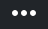
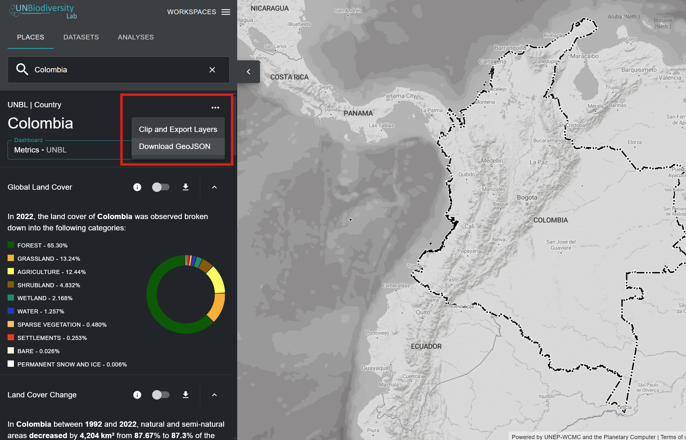
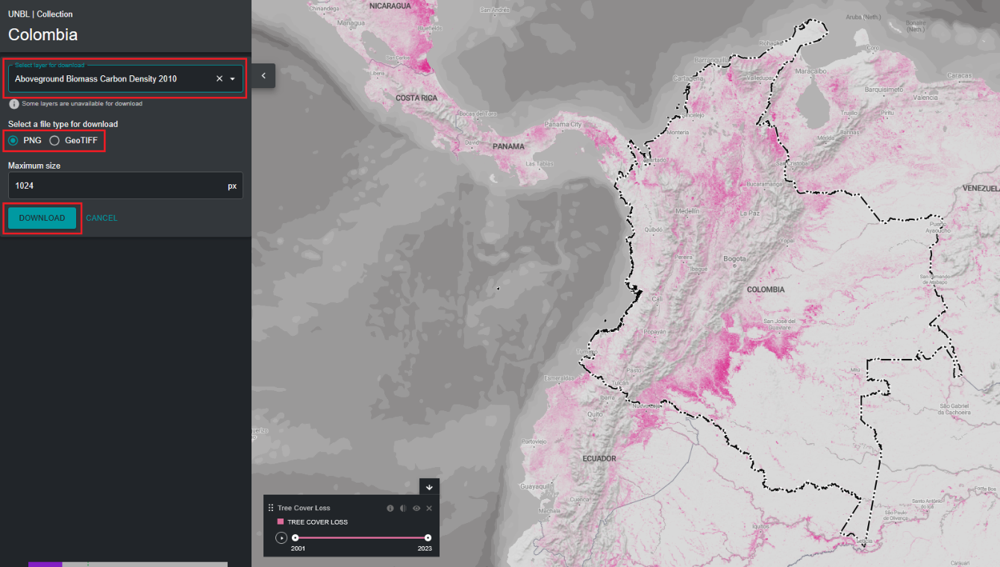

# Como posso recortar e exportar conjuntos de dados?

Os utilizadores registados no UN Biodiversity Lab podem:

- Recortar conjuntos de dados raster para uma área de interesse e descarregá-los para utilização num software SIG para computador — esta função permite aos utilizadores aceder aos dados subjacentes, evitando ao mesmo tempo a largura de banda e o espaço de armazenamento necessários para descarregar e trabalhar com um conjunto de dados global;

- Descarregar o ficheiro de limites de uma área de interesse no formato GeoJSON para utilização num software SIG para computador.

  
▶️ Prefere vídeo? Clique aqui!

  

    <iframe
      src="https://www.youtube-nocookie.com/embed/QWW4Dm1ssBg"
      title="UNBL tutorial"
      frameborder="0"
      allow="accelerometer; clipboard-write; encrypted-media; gyroscope; picture-in-picture; web-share"
      allowfullscreen>
    </iframe>
  

Para o fazer:

1.	Clique no botão 'LOCAIS' e selecione os seus locais de interesse.

2.	Clique no ícone {style="display: inline; width: 1em; height: 1em; width: 2em;"} à direita do nome do país e clique em «Descarregar GeoJSON» para descarregar o ficheiro de limites da sua área de interesse, ou clique em «Recortar e exportar camadas» se pretender recortar e descarregar um conjunto de dados específico. Se escolher a última opção, siga os passos adicionais 3 a 6 descritos abaixo.

	

3.  Escreva o nome ou selecione os dados que pretende descarregar. Se os dados contiverem camadas de vários anos, selecione o ano que pretende descarregar. Tem a opção de descarregar as camadas recortadas em formato raster GeoTIFF ou em formato de ficheiro de imagem PNG.

4. Clique em descarregar.

	- A fonte de dados selecionada será recortada para a caixa delimitadora em torno do país.

	- É adicionada uma pequena margem (buffer) à caixa delimitadora, que alarga ligeiramente a área do raster recortado. Isto ajuda a garantir que eventuais incongruências entre o limite nacional utilizado no UNBL e o ficheiro oficial de limites nacionais que pretenda utilizar não resultem em perda de dados. Pressupõe-se que as diferenças sejam potencialmente pequenas. Se não for o caso, contacte-nos através de <support@unbiodiversitylab.org> para obter assistência.

	!!!Note
		Se estiver a descarregar GeoTIFFs, estes são dados brutos e não incluem informações de estilo.

	

5.	Aceda ao ficheiro comprimido .zip descarregado na sua pasta de transferências assim que a transferência estiver concluída.

6.	Os dados descarregados podem ser abertos em qualquer software SIG para análise adicional.
