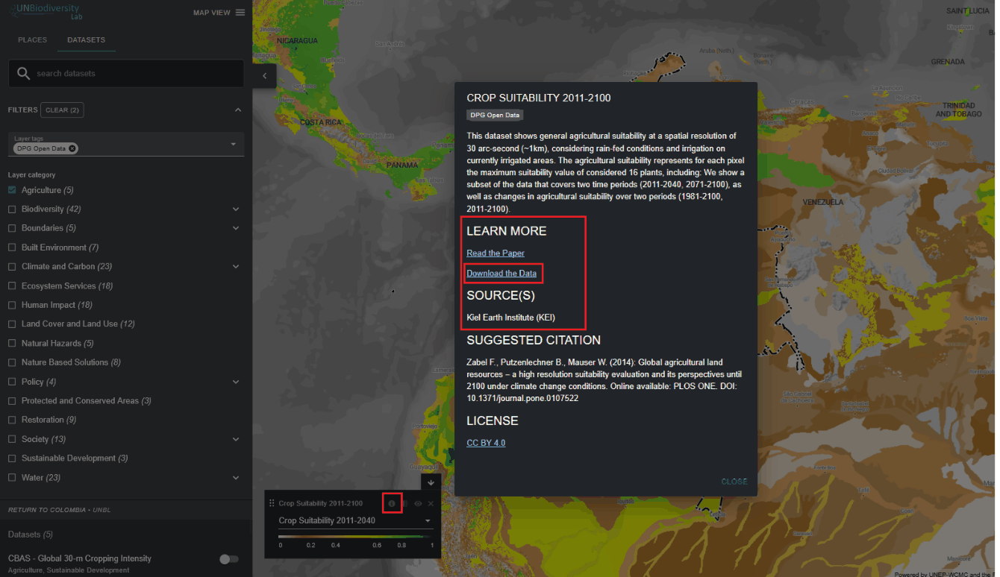

# Como posso descarregar conjuntos de dados globais não recortados?

  
▶️ Prefere vídeo? Clique aqui!

  

    <iframe
      src="https://www.youtube-nocookie.com/embed/XGfgcdWalEo"
      title="UNBL tutorial"
      frameborder="0"
      allow="accelerometer; clipboard-write; encrypted-media; gyroscope; picture-in-picture; web-share"
      allowfullscreen>
    </iframe>
  

1.	Selecione o conjunto de dados de interesse.

2.	Clique no ícone de informações do conjunto de dados.

3.	Clique na ligação em 'SAIBA MAIS' para descarregar os dados da sua fonte original (se não for fornecida nenhuma ligação, isso significa provavelmente que os dados não estão disponíveis publicamente para transferência ou que os fornecedores de dados renunciaram às permissões para incluir a ligação de transferência nos metadados do conjunto de dados no Laboratório de Biodiversidade da ONU).

4.	 Se encontrar algum problema ao aceder aos dados, contacte support@unbiodiversitylab.org para obter apoio adicional.

