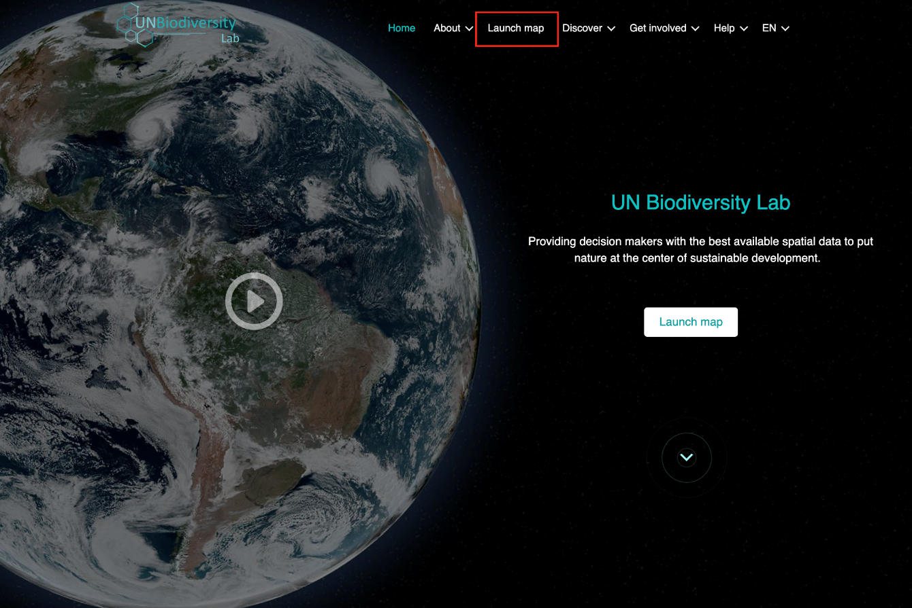
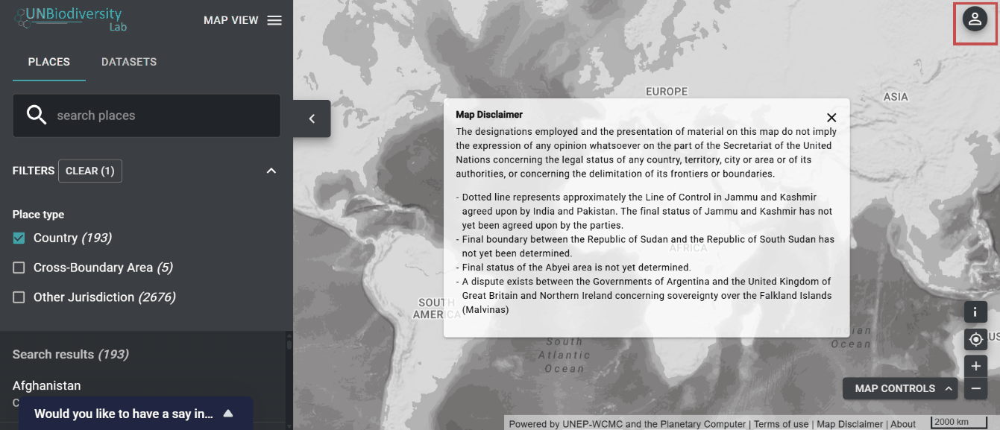
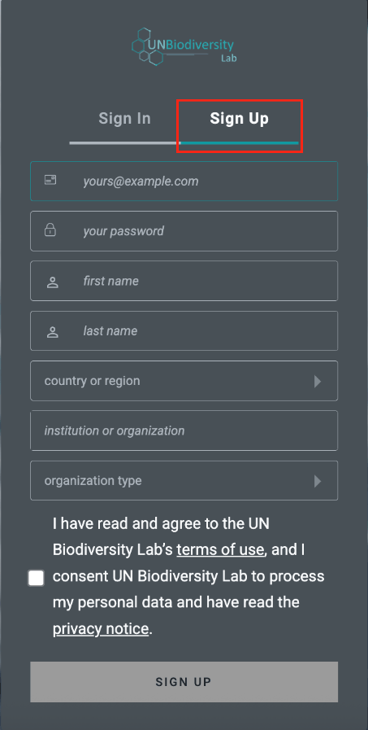
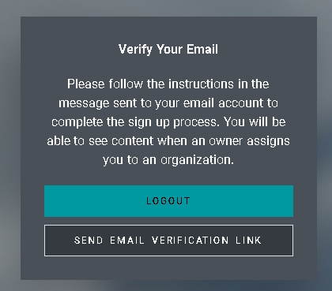
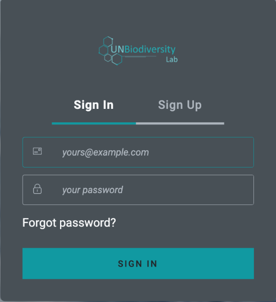
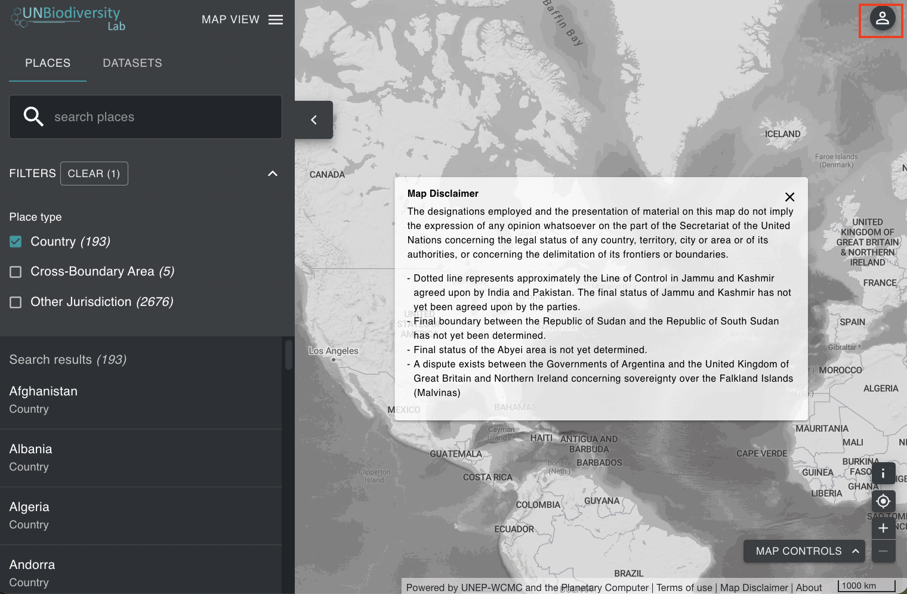
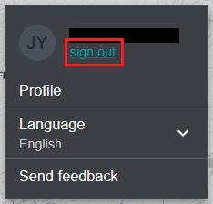

# How do I register or log-in?

Before you begin exploring the maps, register for the UN Biodiversity Lab.

  
▶️ Prefer video? Click here!

  

    <iframe
      src="https://www.youtube-nocookie.com/embed/uA5hMZjAEyA"
      title="UNBL tutorial"
      frameborder="0"
      allow="accelerometer; clipboard-write; encrypted-media; gyroscope; picture-in-picture; web-share"
      allowfullscreen>
    </iframe>
  

1. Click the 'Launch map' button on the [UN Biodiversity Lab](https://unbiodiversitylab.org/) website.

	

2. Once this has loaded, select the account icon in the top right-hand corner and choose 'sign in'. In the loaded page then choose 'sign up'. Enter your email, set your password, name, country, institution/organization, and organization type to sign up.

	

	

3. You will receive an email within a few minutes. Follow the instructions in this email to verify your account. 

	

4. Once your account is verified, you can log in using your email address and password each time you access the platform.

	

5. You can log out at any time by clicking on your user icon and selecting 'Sign Out'.

	
	