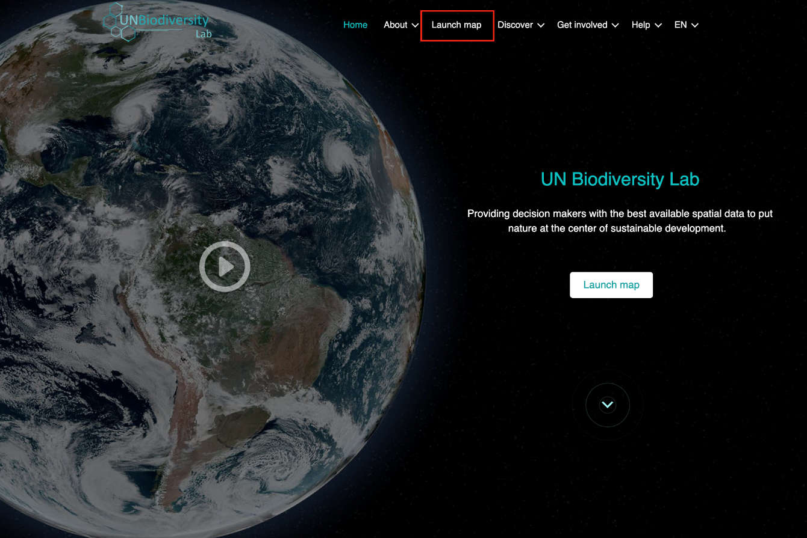
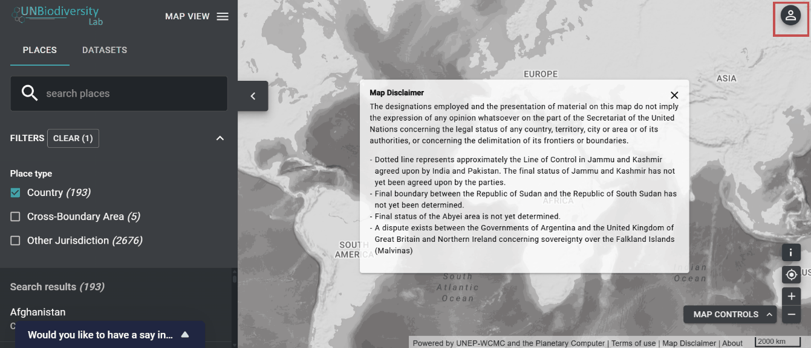
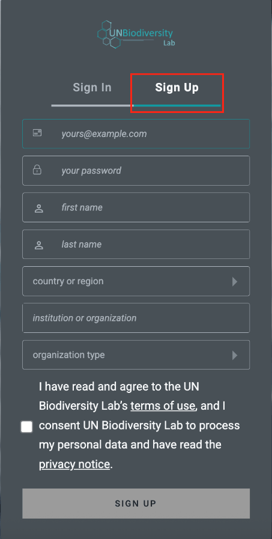
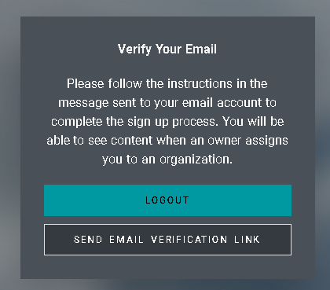
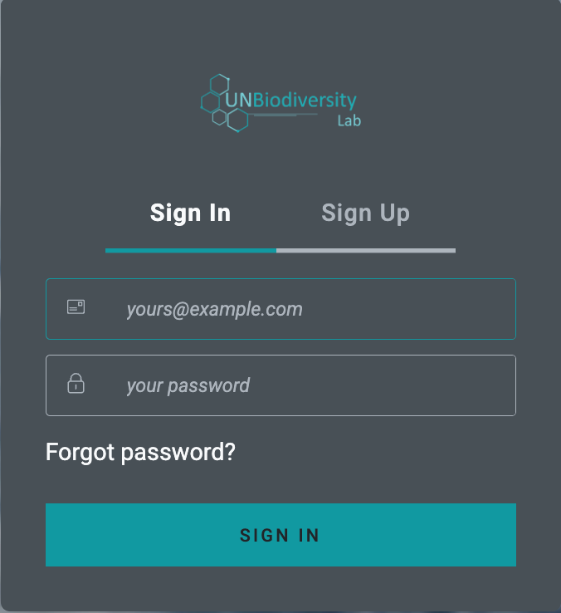
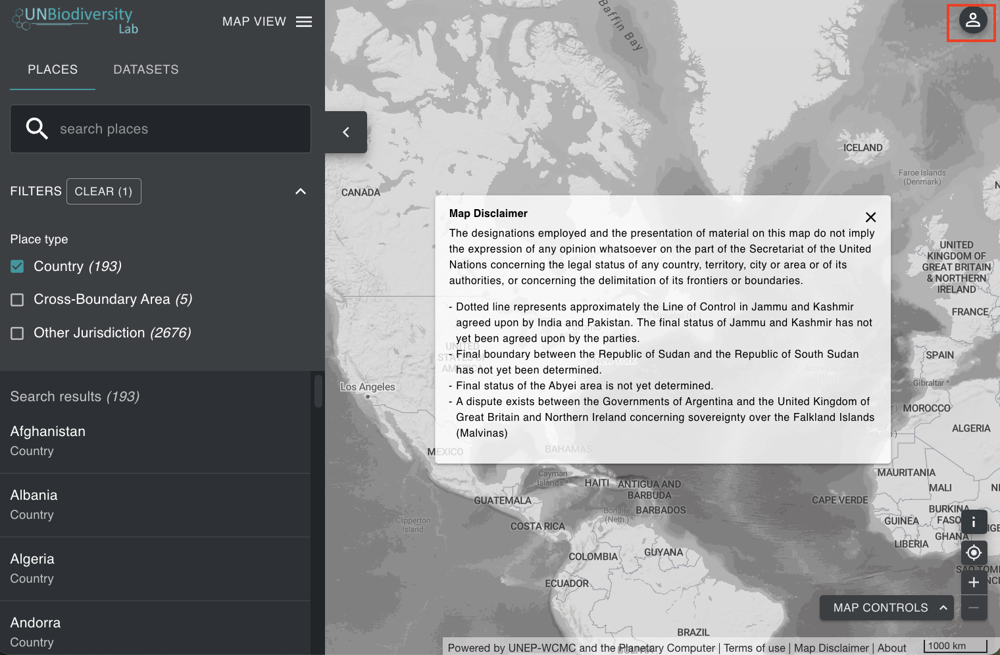
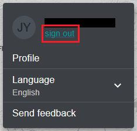

# Como faço para me registrar ou fazer login?

Antes de começar a explorar os mapas, registre-se no Laboratório de Biodiversidade da ONU.

  
▶️ Prefere vídeo? Clique aqui!

  

    <iframe
      src="https://www.youtube-nocookie.com/embed/dpxiCcgJLBM"
      title="UNBL tutorial"
      frameborder="0"
      allow="accelerometer; clipboard-write; encrypted-media; gyroscope; picture-in-picture; web-share"
      allowfullscreen>
    </iframe>
  

1. Clique na página 'Iniciar mapa' do site do [Laboratório de Biodiversidade da ONU](https://unbiodiversitylab.org/).

	

2. Quando esta página for carregada, selecione o ícone da conta no canto superior direito e escolha 'entrar'. Na página carregada, escolha 'inscrever-se'. Insira seu e-mail, defina sua senha, nome, país, instituição/organização e tipo de organização para se inscrever.

	

	

3. Você receberá um e-mail dentro de alguns minutos. Siga as instruções neste e-mail para verificar sua conta.

	

4. Uma vez que sua conta esteja verificada, você pode fazer login usando seu endereço de e-mail e senha cada vez que acessar a plataforma.

	

5. Você pode sair a qualquer momento clicando no ícone de seu usuário e selecionando 'Sair'.

	
	
