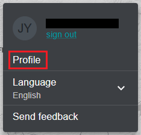
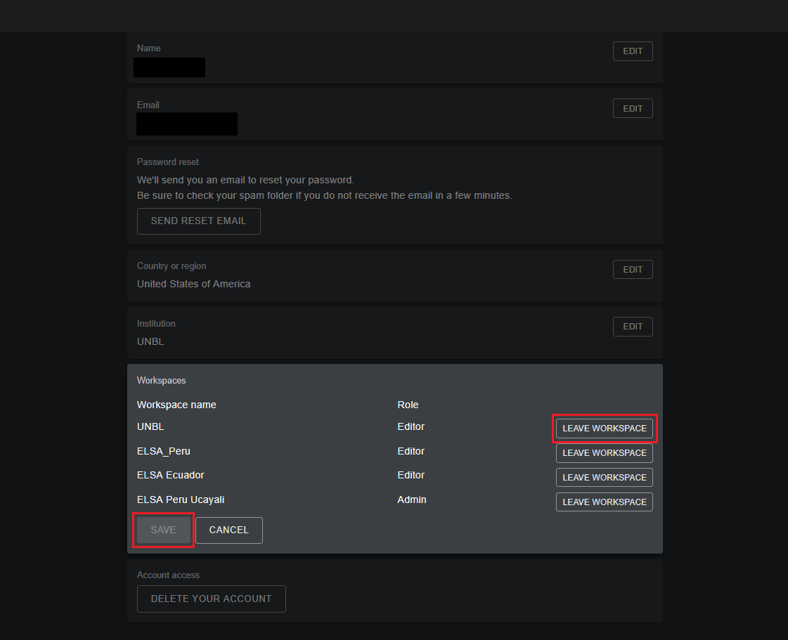
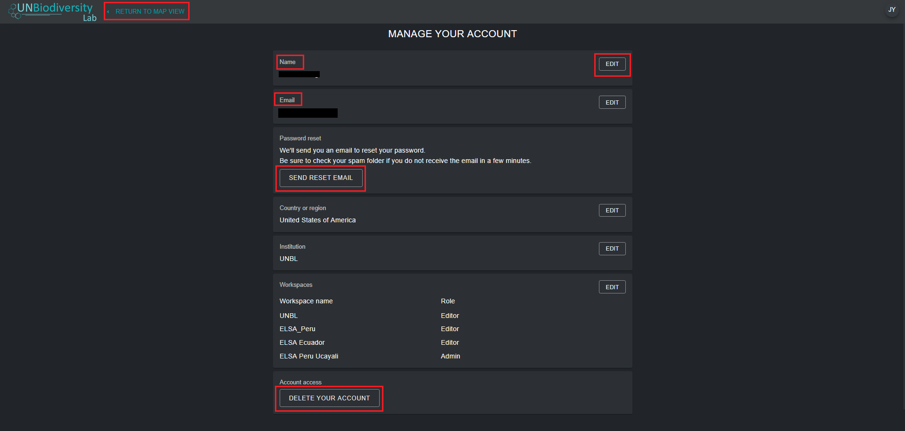

# Como faço a gestão da minha conta?

Depois de se registar no UN Biodiversity Lab, o utilizador poderá gerir a sua conta, incluindo editar o seu nome de utilizador, e-mail, palavra-passe, país e instituição. Poderá também visualizar e editar os espaços de trabalho a que pertence.

  
▶️ Prefere vídeo? Clique aqui!

  

    <iframe
      src="https://www.youtube-nocookie.com/embed/U4lV4CLoTTQ"
      title="UNBL tutorial"
      frameborder="0"
      allow="accelerometer; clipboard-write; encrypted-media; gyroscope; picture-in-picture; web-share"
      allowfullscreen>
    </iframe>
  

**Para gerir a sua conta:**

1. Clique no ícone da conta com as suas iniciais no canto superior direito e, em seguida, clique em 'Perfil'.

	

2. Clique em 'EDITAR' para editar o seu nome de utilizador, e-mail, país e instituição.

3. Para redefinir a sua palavra-passe, clique em 'ENVIAR E-MAIL DE REDEFINIÇÃO' e siga as instruções no e-mail.

4. Para sair de qualquer um dos espaços de trabalho do UNBL a que pertence, clique em 'EDITAR' e, em seguida, em 'SAIR DO ESPAÇO DE TRABALHO'. Guarde as alterações.

	

5. Se esta conta já não estiver em uso, pode clicar em 'ELIMINAR A SUA CONTA' na parte inferior desta página. Após eliminar a conta, terá de se inscrever novamente para obter privilégios de utilizador registado no UN Biodiversity Lab.

6. Após guardar as alterações, clique em 'VOLTAR À VISTA DO MAPA'.

	
