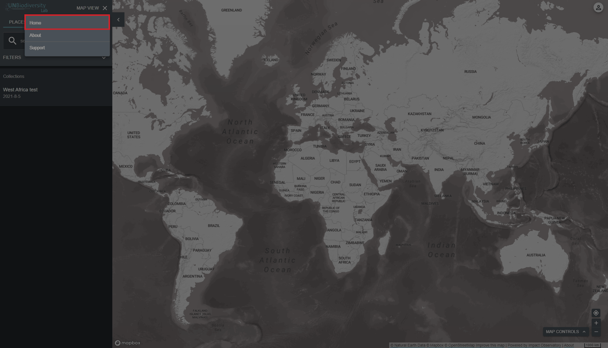
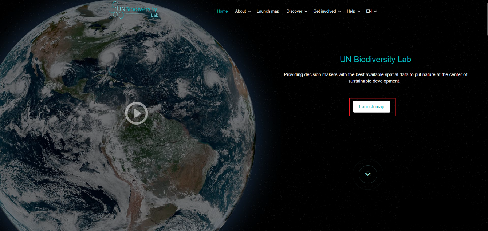

# How do I navigate between the UN Biodiversity Lab website and map app?

Navigating between the two pages is simple:

  
▶️ Prefer video? Click here!

  

    <iframe
      src="https://www.youtube-nocookie.com/embed/ygqQKgeBJC0"
      title="UNBL tutorial"
      frameborder="0"
      allow="accelerometer; clipboard-write; encrypted-media; gyroscope; picture-in-picture; web-share"
      allowfullscreen>
    </iframe>
  

1. To return to the UN Biodiversity Lab website from the map app, click 'MAP VIEW' in the left-side toolbar and choose 'HOME' on the top right of the panel.

	!!! note
		If you are registered on UNBL and own a workspace, please click on 'WORKSPACES' in the left-side tool bar and then on 'HOME'.

	
	
2. To navigate to the map app from the UN Biodiversity Lab website, click on 'Launch map'.

	