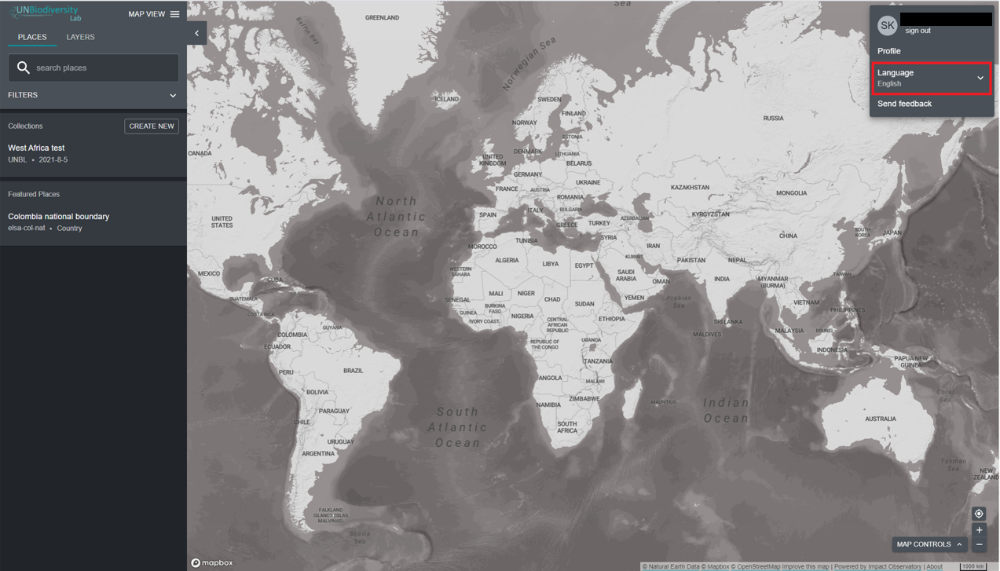

# Como altero o idioma?

O UN Biodiversity Lab está atualmente disponível em **inglês**, **francês**, **espanhol**, **português** e **russo**. O idioma padrão é **inglês**.

  
▶️ Prefere vídeo? Clique aqui!

  

    <iframe
      src="https://www.youtube-nocookie.com/embed/0L9WWXTASJU"
      title="UNBL tutorial"
      frameborder="0"
      allow="accelerometer; clipboard-write; encrypted-media; gyroscope; picture-in-picture; web-share"
      allowfullscreen>
    </iframe>
  

Para alterar o idioma, clique no ícone da conta no canto direito do mapa e clique novamente para selecionar o idioma da sua preferência no menu pendente. Pode alterar o idioma no sítio Web do UN Biodiversity Lab ou na aplicação de mapa.

