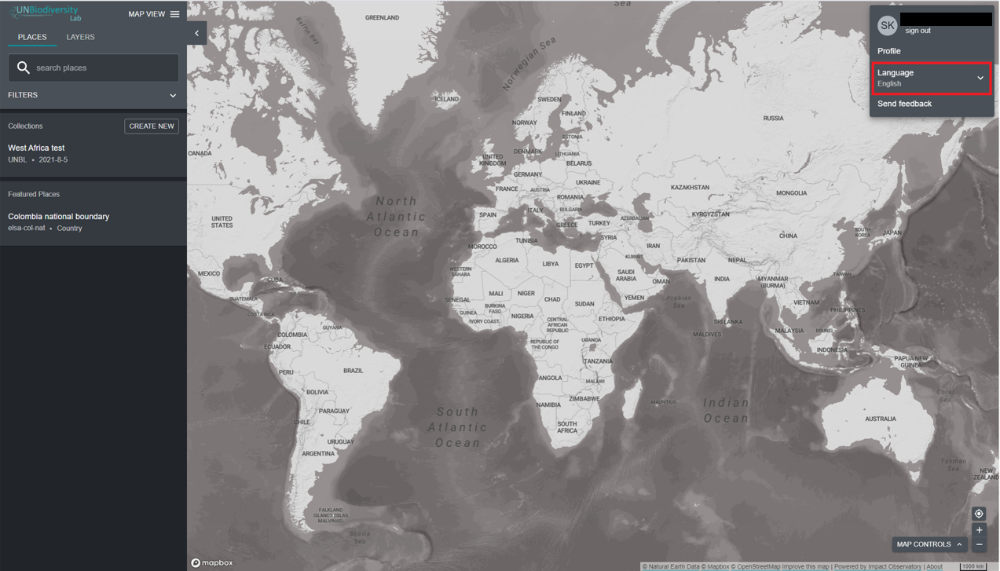

# Как мне изменить язык?

Лаборатория ООН по биоразнообразию в настоящее время доступна на **английском**, **французском**, **испанском**, **португальском** и **русском** языке. Язык по умолчанию — **английский**.

  
▶️ Предпочитаете видео? Нажмите сюда!

  

    <iframe
      src="https://www.youtube-nocookie.com/embed/0L9WWXTASJU"
      title="UNBL tutorial"
      frameborder="0"
      allow="accelerometer; clipboard-write; encrypted-media; gyroscope; picture-in-picture; web-share"
      allowfullscreen>
    </iframe>
  

Чтобы изменить язык, нажмите на значок аккаунта в правом углу карты и нажмите еще раз, чтобы выбрать предпочитаемый язык из раскрывающегося меню. Вы можете изменить язык как на веб-сайте UNBL, так и в картографическом приложении.

