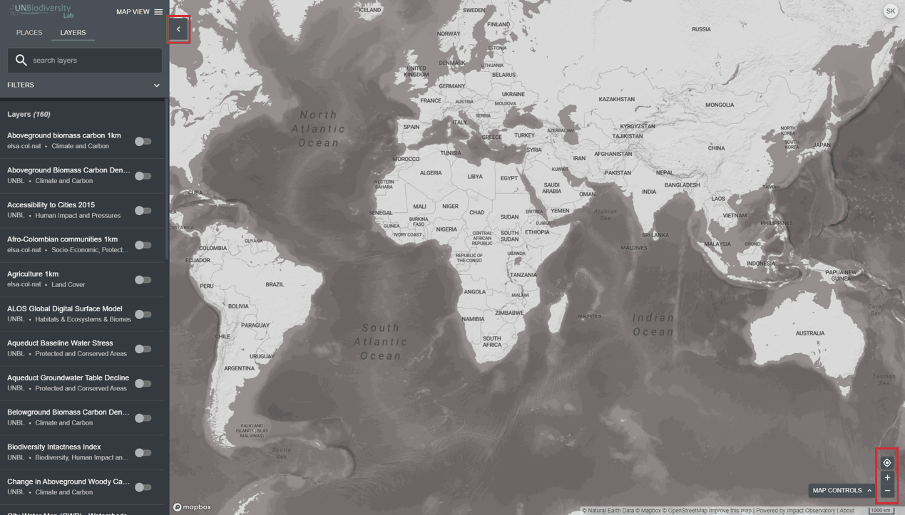

# Como ajusto a visualização do mapa?

  
▶️ Prefere vídeo? Clique aqui!

  

    <iframe
      src="https://www.youtube-nocookie.com/embed/l0HyoPQmEsE"
      title="UNBL tutorial"
      frameborder="0"
      allow="accelerometer; clipboard-write; encrypted-media; gyroscope; picture-in-picture; web-share"
      allowfullscreen>
    </iframe>
  

Existem várias funcionalidades que o podem ajudar a navegar no ecrã do mapa. Estes incluem:

1. *Mover mapa*: Use o rato para clicar e arrastar a parte do mapa que pretende ver para o meio do ecrã.

2. *Aumentar/diminuir zoom:* Clique nos ícones +/- no canto inferior direito do mapa ou use a roda de deslocamento do rato.

3. *Centrar local:* Clique no botão {style="display: inline; height: 2em; width: 2em;"} acima de +/-. Se tiver selecionado um local na barra de menu esquerda, o mapa voltará a ser centrado sobre o local selecionado.

4. *Ocultar barra de menu esquerda:* Clique na seta no topo do menu esquerdo para recolher o painel de conjuntos de dados para uma visualização maior do mapa. Clique novamente para expandir o painel.

