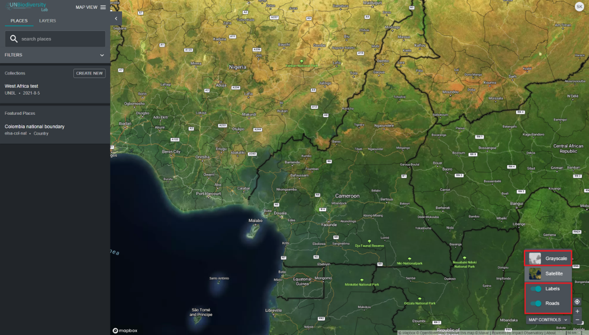

# ¿Cómo puedo añadir o eliminar etiquetas de lugares, carreteras y la vista satelital del mapa base?

  
▶️ ¿Prefieres el vídeo? ¡Haz clic aquí!

  

    <iframe
      src="https://www.youtube-nocookie.com/embed/oHFW1Bg4EAY"
      title="UNBL tutorial"
      frameborder="0"
      allow="accelerometer; clipboard-write; encrypted-media; gyroscope; picture-in-picture; web-share"
      allowfullscreen>
    </iframe>
  

Hay varias opciones para personalizar el mapa base. Están disponibles en el icono «CONTROLES DE MAPA», en la parte inferior derecha, e incluyen:

1. *Etiquetas:* Las etiquetas muestran el nombre de los lugares, incluidos países, estados, ciudades y puntos de referencia representativos. Haga clic en el botón para activar las etiquetas y vuelva a hacer clic para ocultarlas.

2. *Carreteras:* Haga clic en el botón para mostrar las carreteras; desactívelo para ocultarlas.

3. *Fondo del mapa:* Ofrecemos opciones en escala de grises y vista satelital para el fondo del mapa. Haga clic en el botón para activar el fondo que desee.

4. *Globo 3D:* Active *Globo 3D*, en la parte superior del menú «CONTROLES DE MAPA», para ver el mapa como un globo tridimensional en lugar de un mapa plano. Desactívelo para volver al mapa plano. Su elección se guarda en el enlace del mapa, de modo que las personas con las que comparta el enlace verán la misma vista.

