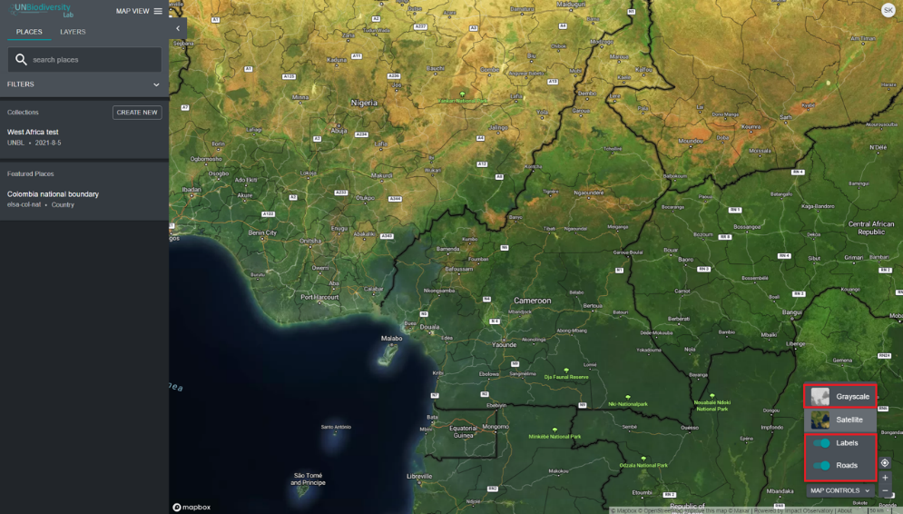

# Comment ajouter/supprimer des étiquettes de lieu, des routes, et la vue satellite de la carte de base ?

  
▶️ Vous préférez la vidéo ? Cliquez ici !

  

    <iframe
      src="https://www.youtube-nocookie.com/embed/7i-Bh-Piivg"
      title="UNBL tutorial"
      frameborder="0"
      allow="accelerometer; clipboard-write; encrypted-media; gyroscope; picture-in-picture; web-share"
      allowfullscreen>
    </iframe>
  

Plusieurs options vous permettent de personnaliser la carte de base. Elles sont disponibles sous l'icône « Commandes de la carte » en bas à droite et comprennent :

1. *Étiquettes :* les étiquettes indiquent le nom des lieux, y compris les pays, les États, les villes et les monuments représentatifs. Cliquez sur le bouton pour activer les étiquettes et cliquez à nouveau pour les masquer.

2. *Routes :* cliquez sur le bouton pour afficher les routes ; désactivez-le pour les masquer.

3. *Arrière-plan de la carte :* nous proposons des options en niveaux de gris et satellite pour l'arrière-plan de la carte. Cliquez sur le bouton pour activer l'arrière-plan de votre choix.

4. *Globe 3D :* activez *Globe 3D*, en haut du menu « Commandes de la carte », pour afficher la carte sous forme de globe en trois dimensions au lieu d'une carte plane. Désactivez-le pour revenir à la carte plane. Votre choix est conservé dans le lien de la carte : les personnes avec qui vous partagez le lien voient donc la même vue.

