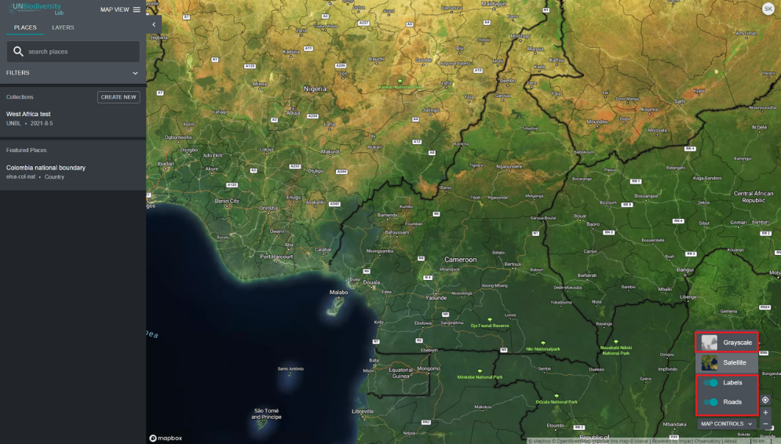

# How do I add/remove place labels, roads, and satellite view from the base map?

  
▶️ Prefer video? Click here!

  

    <iframe
      src="https://www.youtube-nocookie.com/embed/1gdLWJkzdPA"
      title="UNBL tutorial"
      frameborder="0"
      allow="accelerometer; clipboard-write; encrypted-media; gyroscope; picture-in-picture; web-share"
      allowfullscreen>
    </iframe>
  

There are several options for you to customize the base map. These are available under the 'MAP CONTROLS' icon on the bottom right and include:

1. *Labels*: The labels show the name of the places, including countries, states, cities, and representative landmarks. Click the toggle on to activate labels, and click off to hide.

2. *Roads*: Click on the toggle to show roads; toggle off to hide roads. 

3. *Map background*: We offer grayscale and satellite options for the map background. Click the toggle to activate the background of your choice.

4. *3D Globe*: Switch on *3D Globe*, at the top of the 'MAP CONTROLS' menu, to view the map as a three-dimensional globe instead of a flat map. Switch it off to return to the flat map. Your choice is kept in the map's link, so people you share the link with see the same view.

