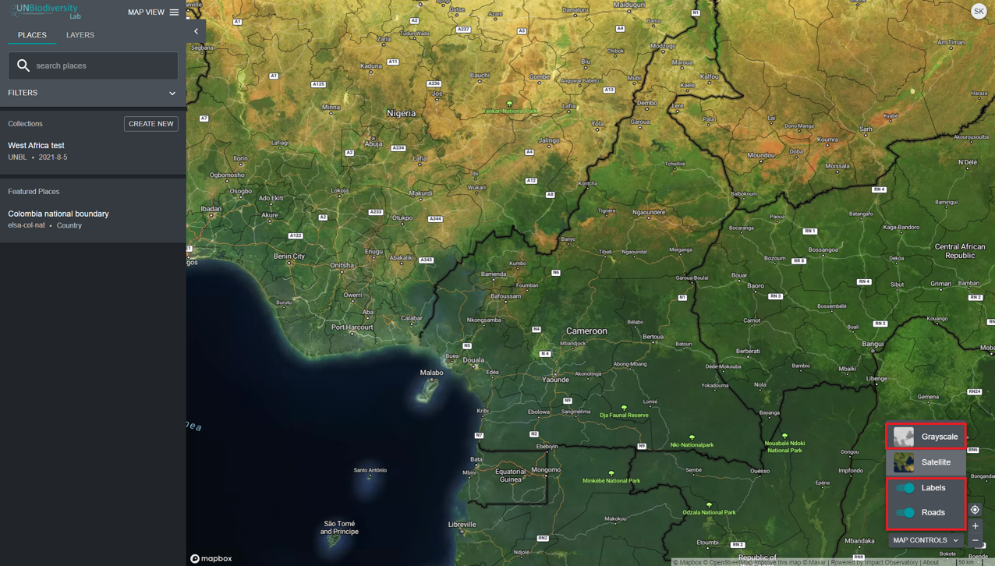

# Como adiciono/removo etiquetas de locais, estradas e a vista de satélite do mapa base?

  
▶️ Prefere vídeo? Clique aqui!

  

    <iframe
      src="https://www.youtube-nocookie.com/embed/JWLRTTfZ75Q"
      title="UNBL tutorial"
      frameborder="0"
      allow="accelerometer; clipboard-write; encrypted-media; gyroscope; picture-in-picture; web-share"
      allowfullscreen>
    </iframe>
  

Existem várias opções para personalizar o mapa base. Estas estão disponíveis no ícone 'CONTROLOS DO MAPA' no canto inferior direito e incluem:

1. *Etiquetas*: As etiquetas mostram o nome dos locais, incluindo países, estados, cidades e marcos representativos. Clique no botão de alternância para ativar as etiquetas e clique novamente para ocultar.

2. *Estradas*: Clique no botão de alternância para mostrar estradas; desative para ocultar estradas.

3. *Fundo do mapa*: Oferecemos opções de fundo em escala de cinzentos e de satélite para o mapa. Clique no botão de alternância para ativar o fundo da sua escolha.

