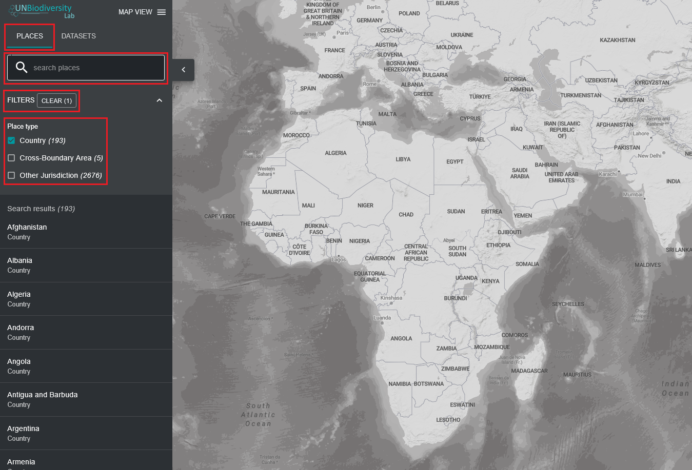

# Como encontro o meu país?

O Laboratório de Biodiversidade da ONU pode ajudá-lo a navegar até uma área específica de interesse e aceder a conjuntos de dados e métricas dinâmicas para esta área. Na nossa plataforma pública, as áreas de interesse incluem países, jurisdições e áreas transfronteiriças selecionadas. 

  
▶️ Prefere vídeo? Clique aqui!

  

    <iframe
      src="https://www.youtube-nocookie.com/embed/H9_uvlB__gI"
      title="UNBL tutorial"
      frameborder="0"
      allow="accelerometer; clipboard-write; encrypted-media; gyroscope; picture-in-picture; web-share"
      allowfullscreen>
    </iframe>
  

Para pesquisar uma área de interesse, pode:

1. Clicar no ícone 'LOCAIS', escrever o nome do país ou jurisdição que pretende visualizar na caixa de pesquisa e selecionar o resultado pretendido na lista de resultados da pesquisa.

	**OU**

2. Clicar no ícone 'LOCAIS', clicar para expandir a caixa de filtros e selecionar o filtro pretendido. Em seguida, pode selecionar o local pretendido na lista de resultados da pesquisa.

