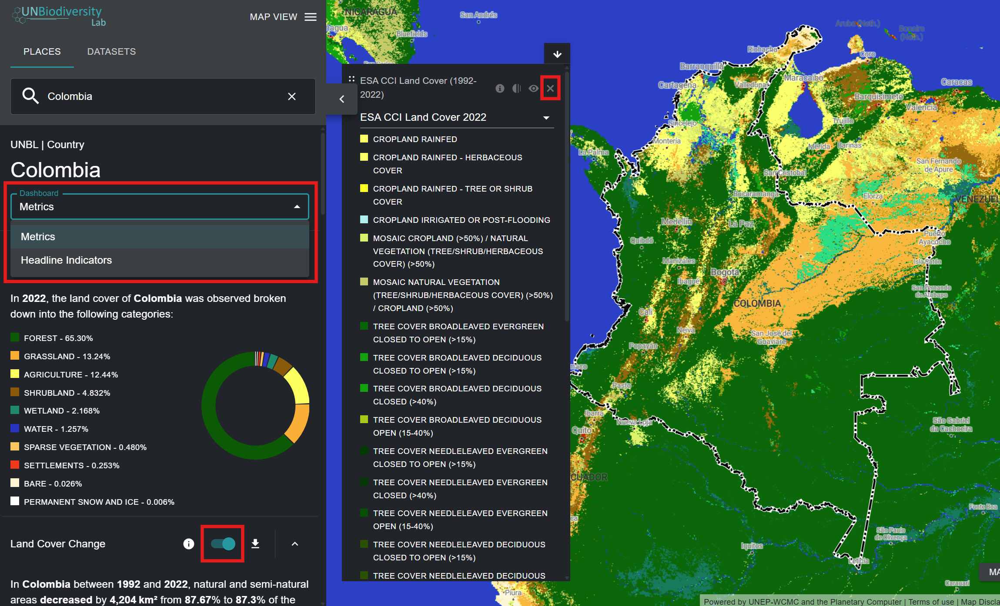
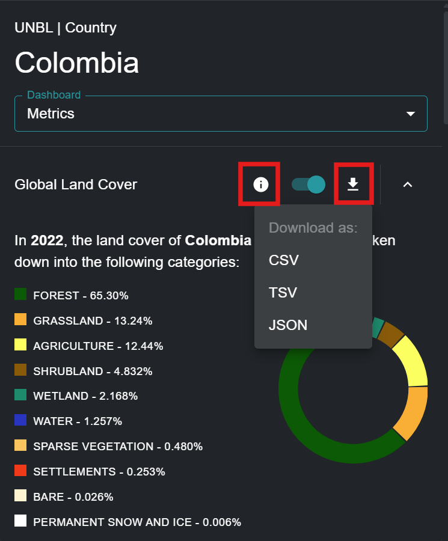

# Que métricas dinâmicas estão disponíveis para o meu país/área de interesse?

O UNBL oferece métricas instantâneas baseadas nos melhores conjuntos de dados espaciais globais disponíveis. Estas métricas podem ser usadas para relatar o estado da natureza e do desenvolvimento humano para locais disponíveis na plataforma pública do UNBL e/ou para aqueles que o utilizador carregou no seu espaço de trabalho (consulte o nosso [guia de espaços de trabalho](../unbl-workspaces/index.md) para mais informações sobre isto). As métricas padrão disponíveis incluem:

- Cobertura Global do Solo (2022)
- Mudança na Cobertura do Solo (1992-2022)
- Áreas Protegidas (2026)
- Índice de Conectividade de Áreas Protegidas (2026)
- Perda de Coberto Arbóreo (2001-2025)
- Atividade Mensal de Incêndios (2001-2025)
- Índice de Integridade da Biodiversidade (2015)
- Densidade de Carbono Terrestre (2010)
- Índice de Vegetação Melhorado (2001-2025)
- Índice Industrial Humano Terrestre (2000, 2005, 2010, 2013)
- Eutrofização Costeira (2007-2024)

O Laboratório de Biodiversidade da ONU oferece adicionalmente dois indicadores principais que estão disponíveis conforme estabelecido nos metadados do indicador associado ao Quadro de Monitorização do Estrutura Global de Biodiversidade de Kunming-Montreal ([CBD/DEC/COP/15/5](https://www.cbd.int/doc/decisions/cop-15/cop-15-dec-05-en.pdf); [CBD/DEC/COP/16/31](https://www.cbd.int/doc/decisions/cop-16/cop-16-dec-31-en.pdf)), que está disponível no [sítio Web de Indicadores do Estrutura Global de Biodiversidade de Kunming-Montreal](https://gbf-indicators.org/) e em [CBD/COP/16/INF/3/Rev.1](https://www.cbd.int/doc/c/ea34/8414/8c5e6797d291af15f33d6e40/cop-16-inf-03-rev1-en.pdf):

- Agricultura Sustentável (Indicador Principal 10.1)
- Gestão Florestal Sustentável (Indicador Principal 10.2)

É importante notar que oito das métricas padrão podem ser apresentadas para locais de qualquer tipo (países, áreas administrativas de qualquer escala, áreas geográficas, etc.), enquanto os dois indicadores principais, as Áreas Protegidas e a métrica do Índice de Conectividade de Áreas Protegidas só podem ser apresentados para locais que sejam **países**. Além disso, a métrica de eutrofização costeira só é calculada para locais que sejam **marinhos**. Esta métrica pode ser visualizada para locais marinhos, bem como para países com litoral que tenham locais marinhos associados. Para saber mais sobre os conjuntos de dados subjacentes a cada uma destas métricas e sobre como as métricas podem ser usadas para monitorização e relato, consulte a tabela abaixo.

*Tabela 1: Informações sobre onze métricas padrão e dois indicadores principais oferecidos no UNBL*

| Nome | O que calcula esta métrica? | Que conjunto de dados é usado para calcular esta métrica? | Como pode isto ser usado para monitorização? |
|------|----------------------------------|-----------------------------------------------|-------------------------------------|
| Cobertura Global do Solo | Percentagem de classificação de cobertura do solo representada dentro do local. | Esta métrica é derivada da camada de dados de Cobertura Global do Solo (ESA), com resolução de 300 m, do ano de 2022. | Esta informação pode ser usada para monitorizar a classificação da cobertura do solo. |
| Mudança na Cobertura do Solo | Mostra a mudança na percentagem de cada classificação de cobertura do solo representada dentro do local entre 1992-2022. | Esta métrica é derivada do conjunto de dados de Cobertura Global do Solo (ESA), com resolução de 300 m, para os anos de 1992-2022. | Mostra a mudança na percentagem da área total que é classificada como antropogénica ou natural. |
| Áreas Protegidas | Percentagem da área total terrestre e marinha que está protegida dentro de um país. | Esta métrica usa dados da Base de Dados Mundial sobre Áreas Protegidas e Conservadas (IUCN, UNEP-WCMC). Esta métrica é atualizada mensalmente. | A WDPCA é atualizada mensalmente e pode ser usada para monitorizar mudanças em áreas legalmente protegidas ou, em conjunto com outros conjuntos de dados, monitorizar a atividade dentro e em redor de áreas protegidas. |
| Índice de Conectividade de Áreas Protegidas | Percentagem da área terrestre total coberta por áreas protegidas conectadas, com limiares de distância de 1, 10 e 100 quilómetros. | Esta métrica obtém as estatísticas diretamente do *pipeline* ProtConn do BON in a Box, que utiliza a WDPCA para calcular a conectividade das áreas protegidas. | O Índice de Conectividade de Áreas Protegidas é um indicador importante para avaliar o progresso em direção ao Objetivo A e à Meta 3 do KMGBF, que visam ter 30% da área terrestre protegida por uma rede de áreas protegidas bem conectadas até 2030. |
| Perda de Coberto Arbóreo | Quilómetros quadrados de perda de coberto arbóreo por ano entre 2001-2025 para um determinado local. | Esta métrica é derivada do conjunto de dados de Perda Anual Acumulada de Coberto Arbóreo do Global Forest Watch (UMD), com resolução de 30 m, do ano 2001 até 2025. | Esta informação pode ajudar a monitorizar quando e onde está a ocorrer desflorestação, bem como se está a aumentar ou a diminuir dentro da sua área de interesse. |
| Atividade Mensal de Incêndios | Quilómetros quadrados mensais de área queimada entre 2001 – 2025 para um determinado local. | Esta métrica é derivada do produto de dados de Área Queimada NASA MODIS Versão 6, com resolução de 500 m, do ano 2001 até 2025. | A atividade mensal de incêndios pode ser analisada para monitorizar tendências sazonais de incêndios e relatar aumentos ou diminuições em incêndios de origem humana e natural. |
| Índice de Integridade da Biodiversidade | Histograma que mostra a distribuição dos dados do Índice de Integridade da Biodiversidade dentro do local. | Esta métrica é derivada da camada de dados do Índice de Integridade da Biodiversidade (UNEP-WCMC, NHML), com resolução de 1 km, de 2015. | Esta informação ilustra se o habitat se tornou mais intacto ou menos intacto, afetando, portanto, a biodiversidade sobre a área de interesse. Pode dar informações sobre destruição, fragmentação ou restauração de habitat. |
| Densidade de Carbono Terrestre | Massa total de carbono armazenada no solo e biomassa e densidade média de carbono dentro de um local. | Esta métrica é derivada da camada de dados de Densidade de Carbono Terrestre (NatureMap, UNEP-WCMC), com resolução de 300 m, do ano de 2010. | Uma série temporal deste conjunto de dados permite a monitorização do carbono armazenado através de soluções baseadas na natureza (vegetação e solo). |
| Índice de Vegetação Melhorado | Mudança na produtividade média da vegetação entre 2001-2025 para um determinado local. | Esta métrica é derivada do conjunto de dados do Índice de Vegetação Melhorado (EVI) (NASA MODIS), medindo a produtividade cumulativa anual da vegetação de 2001 a 2025. | O EVI pode ser usado para monitorizar a saúde vegetativa sobre uma área como um indicador de várias condições anormais, como seca e mudanças no uso da terra. |
| Índice Industrial Humano Terrestre | Mostra a mudança na distribuição das pontuações do índice industrial humano para um determinado local entre 2000-2013, agrupadas em categorias de 'altamente intacto', 'ecologicamente intacto', 'convertido', 'altamente convertido' e 'totalmente convertido'. | Esta métrica é derivada do Índice Industrial Humano Terrestre (WCS, UNBC) dos anos 2000, 2005, 2010 e 2013. | O Índice Industrial Humano Terrestre pode ser usado para monitorizar o impacto do desenvolvimento e da infraestrutura humana nos ambientes circundantes e áreas de interesse. |
| Eutrofização Costeira | Mostra a mudança na distribuição das tendências de eutrofização costeira, através de indicadores indiretos da concentração de clorofila-a, para determinados locais costeiros e/ou marinhos entre 2007-2024, agrupadas em várias categorias que definem a intensidade e a direção da tendência de eutrofização. | Esta métrica usa o Global Eutrophication Watch, um quadro geoespacial para a triagem preliminar do Potencial de Eutrofização Costeira (CEP). A versão no UNBL usa como dado principal o conjunto de dados de 4 km de resolução da ESA-CCI (Ocean Colour Climate Change Initiative). | Esta métrica pode ser usada para identificar pontos críticos ambientais e monitorizar a evolução da qualidade da água costeira ao longo do tempo. |
| Agricultura Sustentável | Mostra os dados reportados pelo país para o indicador principal 10.1 do KMGBF relacionados com o progresso em direção à agricultura produtiva e sustentável. | Esta métrica exibe os dados fornecidos por cada país à FAO. | Mede a terra sob agricultura produtiva e sustentável, expressa como uma proporção da área de terra agrícola do país através de 11 subindicadores. |
| Gestão Florestal Sustentável | Mostra os dados reportados pelo país para o indicador principal 10.2 do KMGBF relacionados com o progresso em direção à gestão florestal sustentável. | Esta métrica exibe os dados fornecidos por cada país à FAO. | Mede o progresso em direção à Gestão Florestal Sustentável através de cinco subindicadores, incluindo mudança anual na área florestal, biomassa acima do solo em floresta, proporção de área florestal dentro de áreas protegidas legalmente estabelecidas, proporção de área florestal com plano de gestão de longo prazo e área florestal sob um esquema de certificação de gestão florestal verificado independentemente. |

Para visualizar estas métricas no Laboratório de Biodiversidade da ONU:

  
▶️ Prefere vídeo? Clique aqui!

  

    <iframe
      src="https://www.youtube-nocookie.com/embed/_QaLrIBDx34"
      title="UNBL tutorial"
      frameborder="0"
      allow="accelerometer; clipboard-write; encrypted-media; gyroscope; picture-in-picture; web-share"
      allowfullscreen>
    </iframe>
  

1.	Selecione um país específico ou área de interesse no separador 'LOCAIS'.

2.	Reveja as métricas no painel esquerdo. Escolha entre uma lista das dez métricas dinâmicas terrestres, da métrica marinha ou dos dois indicadores principais, clicando e selecionando a opção pretendida («METRICS», «MARINE METRICS» ou «HEADLINE INDICATORS») no painel de controlo apresentado.

3.	Clique no botão de alternância ao lado de qualquer métrica específica se quiser visualizar este conjunto de dados no mapa. Clique no botão de alternância novamente ou no ícone de remover conjunto de dados na legenda para limpar o ecrã.

	

4.  Clique no ícone {style="display: inline; width: 1em; height: 2em; width: 2em;"} para visualizar informações do conjunto de dados. As páginas de informações fornecem uma breve descrição dos dados, artigo relacionado para leitura, dados brutos para descarregar (se disponíveis gratuitamente) e especificações de licença.

5.	Para descarregar dados resumidos da métrica em formato .csv, .tsv ou .json, clique no ícone de seta {style="display: inline; width: 1em; height: 2em; width: 2em;"}. Também pode descarregar os dados dos links de origem nas páginas de informações dos conjuntos de dados.

	
