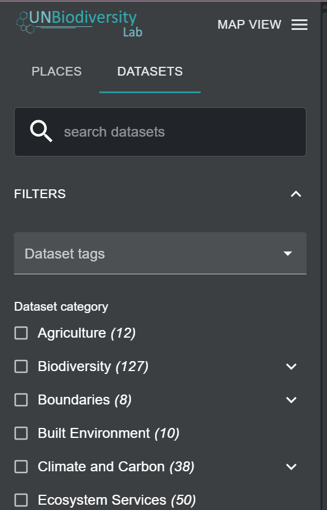
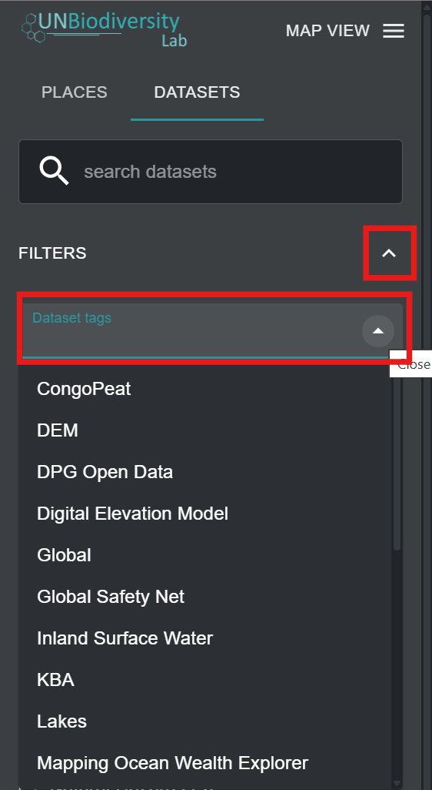
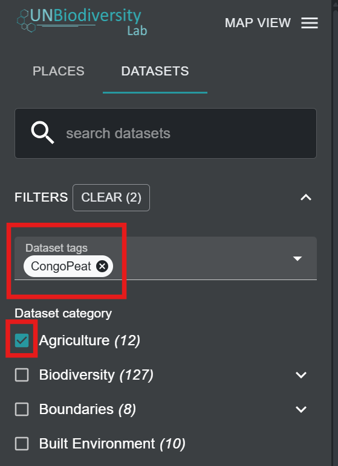
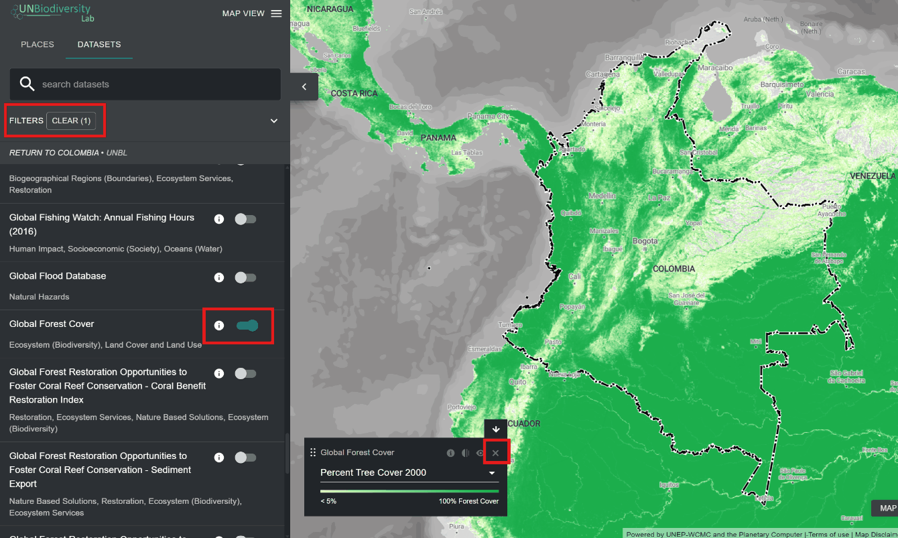

# Como encontro conjuntos de dados adicionais para o meu país?

Os dados no UN Biodiversity Lab incluem os melhores conjuntos de dados globais disponíveis relacionados com a natureza e o bem-estar humano, variando de biodiversidade a serviços dos ecossistemas, a dados socioeconómicos. Também incluímos conjuntos de dados regionais quando recomendado pelos utilizadores do UN Biodiversity Lab. Pode visualizar conjuntos de dados no UN Biodiversity Lab globalmente ou dentro de uma área de interesse.

!!! note
	Referimo-nos tanto a conjuntos de dados quanto a camadas de dados neste guia e no UNBL. Cada conjunto de dados pode ter uma ou múltiplas camadas de dados dentro dele.
	

  
▶️ Prefere vídeo? Clique aqui!

  

    <iframe
      src="https://www.youtube-nocookie.com/embed/5ulltlITEnw"
      title="UNBL tutorial"
      frameborder="0"
      allow="accelerometer; clipboard-write; encrypted-media; gyroscope; picture-in-picture; web-share"
      allowfullscreen>
    </iframe>
  

1.	Navegue até à sua área de interesse, se preferir. Também pode permanecer na vista global.

2.	Clique no ícone do separador 'CONJUNTOS DE DADOS'.

3.	Para pesquisar um conjunto de dados, pode:

	a) Escreva o nome do conjunto de dados que pretende visualizar na caixa de pesquisa e selecione o resultado pretendido na lista de conjuntos de dados (nota: a sua pesquisa deve incluir pelo menos 3 caracteres).

    **OU**

    b) Clique para expandir os filtros para visualizar e selecionar as categorias de conjuntos de dados do seu interesse. Em seguida, pode selecionar o conjunto de dados pretendido na lista de resultados da pesquisa.

	

	**OU**

	c) Clique para expandir as etiquetas de conjuntos de dados e selecione a etiqueta pretendida. Em seguida, pode selecionar o conjunto de dados pretendido na lista.

	
	

4.	Clique no botão de alternância à direita do nome do conjunto de dados para carregar este conjunto de dados no mapa.

5.	Clique no botão de alternância novamente ou clique no ícone **X** na legenda do conjunto de dados para remover este conjunto de dados.

	
