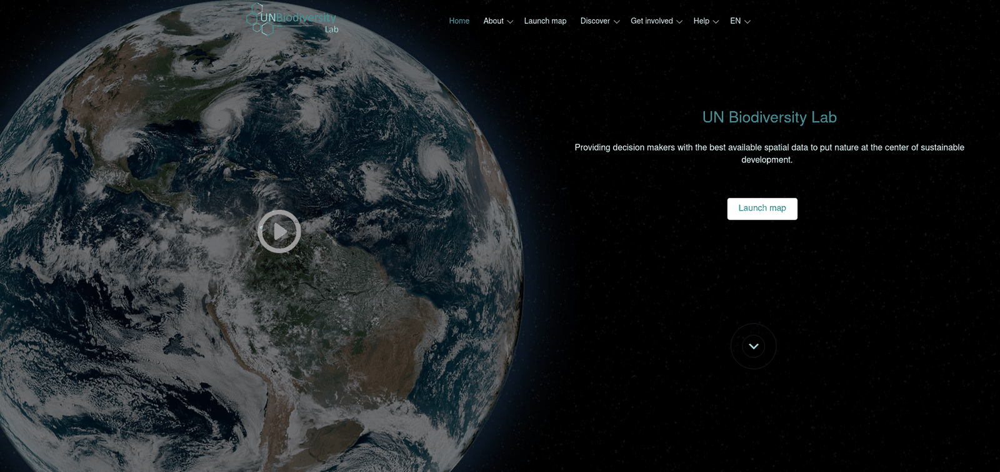

# Guia do Utilizador da Plataforma Pública do Laboratório de Biodiversidade da ONU (UNBL)

Este guia do utilizador, disponível para descarregar, foi desenvolvido para o orientar através das principais ferramentas e funções do Laboratório de Biodiversidade da ONU. Se tiver outras perguntas, visite a nossa [página de apoio](https://unbiodiversitylab.org/en/support/) ou contacte-nos através de support@unbiodiversitylab.org.

Este guia aborda as seguintes questões:

## Índice

- **[Como me registo ou inicio sessão?](1_register.md)**
- **[Como faço a gestão da minha conta?](2_manage.md)**
- **[Como navego entre o sítio Web do Laboratório de Biodiversidade da ONU e a aplicação de mapas?](3_navigate.md)**
- **[Como altero o idioma?](4_language.md)**
- **[Como ajusto a visualização do mapa?](5_adjust_mapview.md)**
- **[Como adiciono/removo etiquetas de locais, estradas e a vista de satélite do mapa base?](6_manage_labels_and_basemaps.md)**
- **[Como encontro o meu país?](7_find_country.md)**
- **[Que métricas dinâmicas estão disponíveis para o meu país/área de interesse?](8_dynamic_metrics1.md)**
- **[Como encontro conjuntos de dados adicionais para o meu país?](9_find_layers.md)**
- **[Como encontro os conjuntos de dados abertos de Bem Público Digital (DPG)?](10_find_dpg_layers.md)**
- **[Como encontro mais informações sobre cada conjunto de dados?](11_find_layer_info.md)**
- **[Como personalizo as visualizações dos conjuntos de dados?](12_customize_mapview.md)**
- **[Que opções tenho para visualizar conjuntos de dados de séries temporais?](13_time_series_data.md)**
- **[Como partilho um conjunto de dados?](14_share_data.md)**
- **[Como recorto e exporto conjuntos de dados?](15_clip_export.md)**
- **[Como descarrego conjuntos de dados globais não recortados?](16_download_global_data.md)**
- **[Como crio um mapa para incluir em relatórios e produtos de comunicação?](17_maps_for_reports.md)**
- **[Como sugiro mais dados para inclusão no Laboratório de Biodiversidade da ONU?](18_suggest_data.md)**
- **[O que são os espaços de trabalho do UNBL? Como solicito um espaço de trabalho do UNBL?](19_private_workspaces.md)**
- **[E se a minha pergunta não tiver resposta?](20_support.md)**

