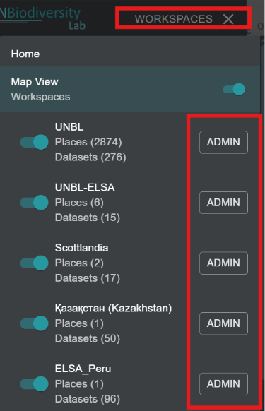
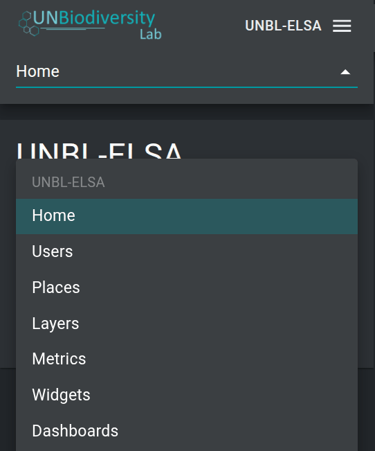

# Navegar na interface de administração do espaço de trabalho

## Como acedo à interface de administração?

Para adicionar e gerir utilizadores, lugares e conjuntos de dados no seu espaço de trabalho, precisa de aceder à interface de administração do seu espaço de trabalho. Para fazer isto:

1.	Clique no botão 'WORKSPACES' no canto superior esquerdo.

2.	Selecione o botão 'ADMIN' associado ao espaço de trabalho da sua escolha.

3.	A página de administração do seu espaço de trabalho também pode ser acedida no seguinte URL:

	>https://map.unbiodiversitylab.org/admin/[NOMEDOSLUGDOSEUESPACO]

## Que componentes estão disponíveis na interface de administração?

Pode navegar na interface de administração usando o menu suspenso na secção superior do painel esquerdo. Dependendo da sua função no espaço de trabalho pode gerir *Users*, *Places*, *Layers*, *Metrics*, *Widgets* e *Dashboards*.

Para aceder aos vários componentes:

1.	Clique no botão 'Home' para expandir o menu suspenso.

2.	Selecione o componente que deseja ver. Mais informação sobre cada componente é fornecida em secções posteriores deste guia do utilizador.

