# Adding Places to Your Workspace and Viewing Dynamic Metrics for Them

## How do I add places?

Adding a new place to your workspace provides you with the ability to utilize all functionalities of UNBL for any area of interest (protected area, subnational administrative level, transboundary area, indigenous community boundary, etc.). Once the place has been added to your UNBL workspace, you will be able to: (1) display UNBL's standard dynamic metrics for this area of interest; (2) display your own custom metrics (as zonal statistics) for this area of interest; and (3) clip any raster layer published on the UNBL public platform (with an open-access licence) to this area of interest and then download it as a GeoTIFF file for further work in a desktop GIS software. Adding a place involves uploading a vector file (polygon or multipolygon) to UNBL. For further details around privacy of uploaded data, please see our [overview sheet on data security](data_security.md).

To add a new place:

1.	Navigate to the ‘Places’ page from the dropdown menu on the left-hand side of the admin interface.
 
2.	Click the ‘CREATE NEW PLACE’ button. 

	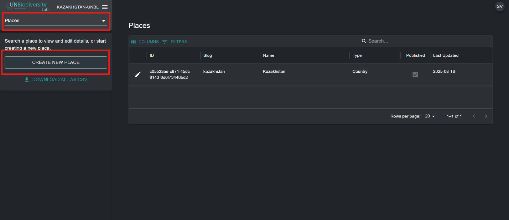
	
3.	In the ‘New place’ page that appears, fill in the following information: 

	a.	*Title*: Insert place name. We recommend keeping these short and clear. Currently, no special characters are allowed. 
	
	b.	*Place type*: Select the appropriate class from the dropdown menu. This will be helpful for filtering your searches later. You can choose from *Biome or Ecosystem, Community and Indigenous Area, Country, Cross-Boundary Area, Marine, Other Jurisdiction, Protected Area, Species Range,* or *Study Area*.
	
	!!! note
		Choosing the *Country* type will prompt you to optionally enter an ISO3/M49 country code for your country. This will allow dynamic metrics and headline indicators that are only available for country-level places to be displayed for your area of interest.
	
	c.	*Slug*: Insert a unique identifier for the place that contains only lowercase letters, numbers, and hyphens. No spaces can be used. This will uniquely identify your place from all others within the UNBL system. We recommend using the ‘GENERATE A SLUG NAME’ button to help you generate an appropriate slug. 
	
	d.	*Place shape*: Upload a polygon (or multipolygon) file to define your place  . Supported formats are GeoJSON (.geojson, .geojsonl), Google Earth files (.kml, .kmz), or ESRI Shapefiles (.zip containing .shp, .dbf, .shx, .prj files). If using a GeoJSON, the file size must not be larger than 6MB. The system allows for uploads up to 6MB, but we strongly recommend using files no more than 2MB for optimal rendering and metrics calculations. If using Google Earth files or ESRI Shapefiles, ensure the coordinate reference system is WGS-84, also known as EPSG: 4326.

	Instead of uploading a file, you can draw the place directly on the map. Select the *Draw on Map* tab, click the edit button, then click on the map to add the corners of your polygon. You can:

	- draw several polygons, or polygons with holes;
	- move a corner by dragging it, or add a corner by clicking near an existing one;
	- delete a polygon, and undo your recent changes;
	- rename a shape by double-clicking its name, typing the new name and pressing Enter.

	While drawing, you can use the map controls to switch to the satellite base map and to show labels, roads or the 3D globe, which makes it easier to trace coastlines, rivers and other features. You can also use the *Draw on Map* tab on a place's edit page to change the shape of an existing place.
	
	e.	If all the information entered is valid, the ‘SAVE AND VIEW DETAILS’ button will light up in blue. Click this button to upload your place to UNBL.
	
	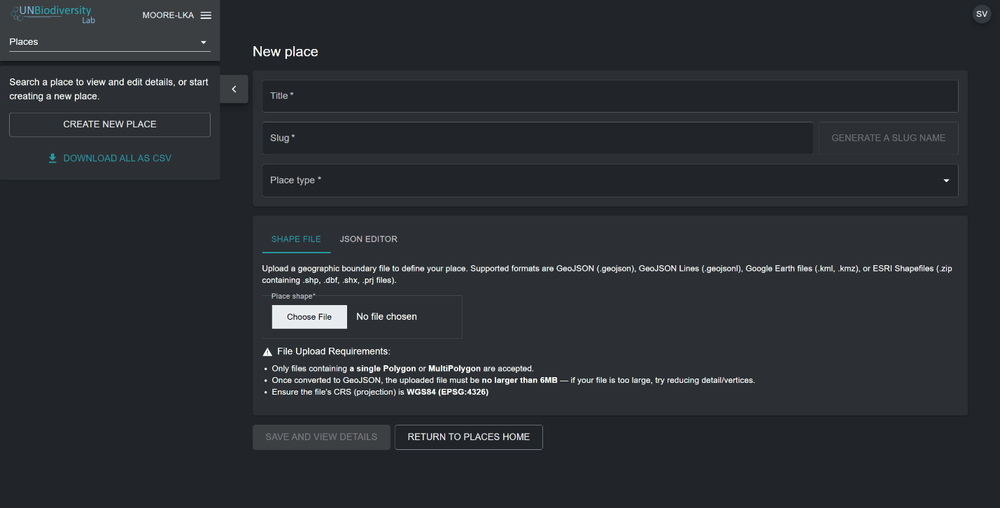
	
4.	Once you save your new place, you will be brought to the place’s edit page. For your place to be discoverable and viewable in the map view, you must publish the place by clicking the ‘Published’ toggle button. Unpublished places remain in the admin interface until you are ready to publish them to the UNBL map view.

	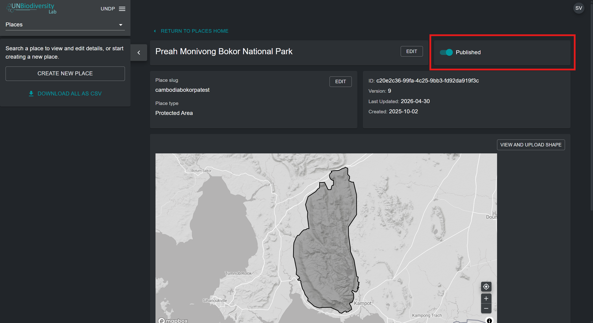

## How do I edit places? 

You can also make edits to existing places and view your place on  a basemap to visually inspect that the file is correctly oriented in the map view. To do this:

1.	Navigate to the ‘Places’ page from the dropdown menu on the left-hand side of the admin interface. 

2.	Select the place you are interested in from the place list by clicking on the {style="display: inline; width: 1em; height: 2em; width: 2em;"} icon on the left-most side of the place entry.

	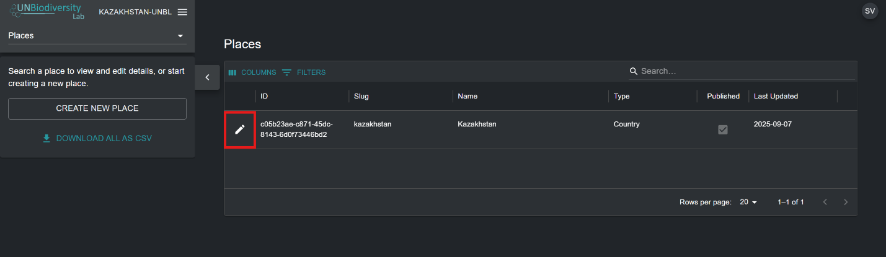
	
3.	Click on the ‘VIEW AND UPLOAD SHAPE’ button near the top-right corner of the basemap window to see some basic geospatial information about your place – including bounding box (extent) coordinates, area of the place in hectares, and the origin point coordinates - and upload any new versions of the place you may have in the future. 

	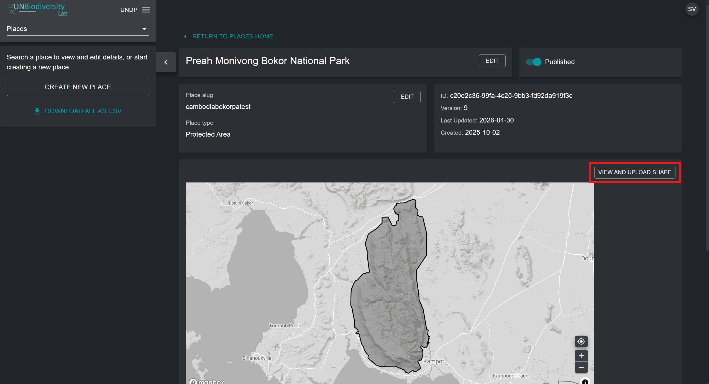
	
4.	Use the ‘Choose File’ button to upload new files for your updated place. Click on ‘UPDATE SHAPE’ to save your changes. You can also download your current version of this place to your local computer as a GeoJSON by clicking on the ‘Download GeoJSON’ button (below the map view).

	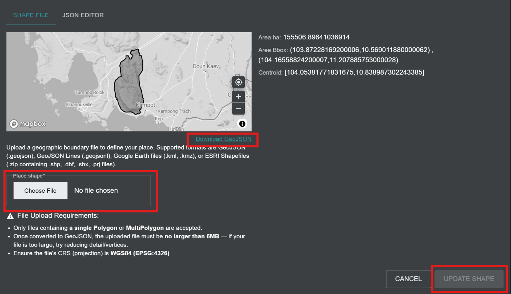

## How do I display metrics for my added places?  

UNBL's standard dynamic metrics become automatically available for your place as soon as you upload it onto UNBL. To display dynamic metrics for places within your UNBL workspace:

1.	a) Click on the 'VIEW ON MAP' button at the bottom of the place edit page. 

	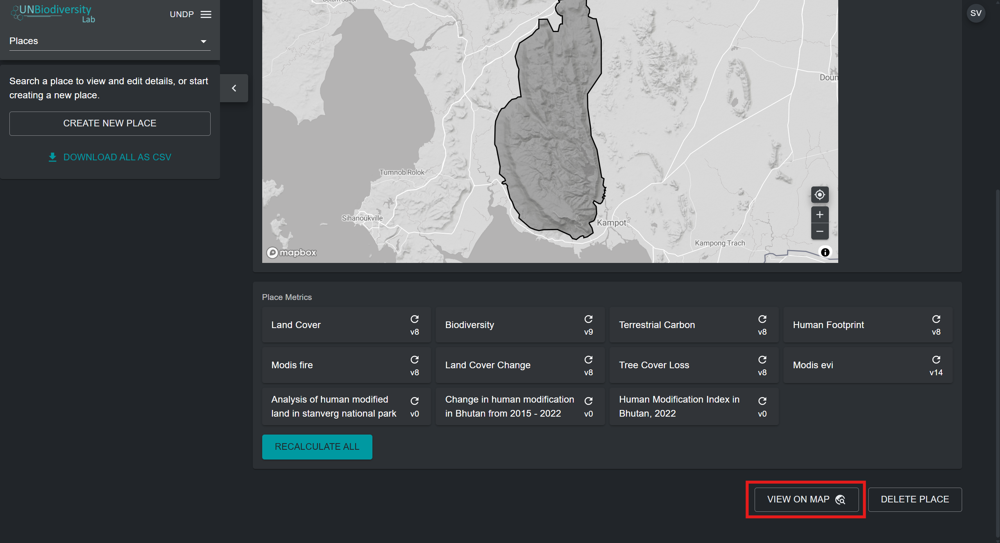
	
	**OR**
	
	b) Navigate to the UNBL map view by clicking on your workspace name in the workspace admin interface in the top-left corner, and then click on ‘Map View’. 

	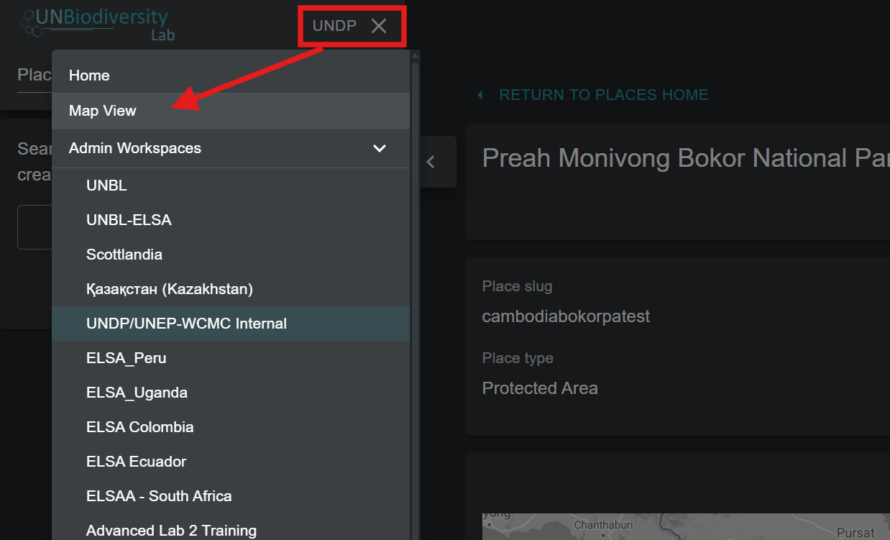
	
	In the ‘PLACES’ tab, search for and select a place uploaded to your UNBL workspace.    

	!!! note
		Places are filtered by *Country* type by default upon opening the UNBL map view.  If your place is of a different category, such as a Protected Area or Cross-Boundary Area and not *Country* type, then you need to click on the ‘CLEAR’ button to clear all filters, or expand the ‘FILTERS’ dropdown menu and uncheck the country box and select your filter of interest to find your place.

2.	Upon selecting a place, dynamic metrics will automatically be displayed for it in the left panel. Choose between a list of the ten standard dynamic metrics, marine metric, or two headline indicators by clicking on either the ‘Metrics’, 'Marine metrics', or ‘Headline indicators’ button. 

	!!! note
		Headline indicator metrics and the Protected Area metric are only available for *Country* type places with a specified ISO3/M49 country code. Places that are not *Country* types will therefore not have an option to choose headline indicators. 
		
	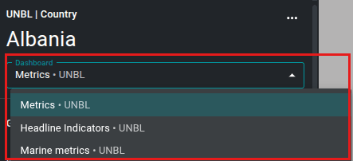
	
3.	Click on the toggle button next to any specific metric if you want to view this dataset on the map. Click on the toggle button again or the {style="display: inline; width: 1em; height: 2em; width: 2em;"} icon in the layer legend to remove this dataset from the map view. You can also click on the upwards arrow icon to hide the metric from view in the available metrics tab, and vice versa.

	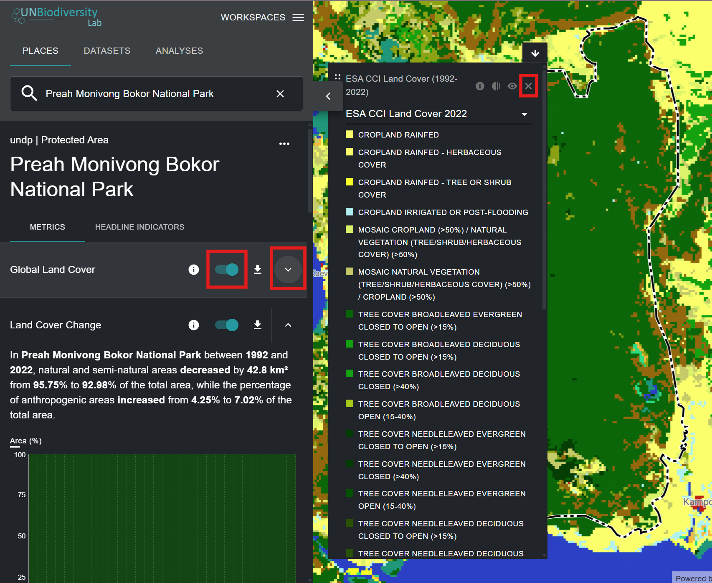
	
4.	Click on the 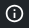{style="display: inline; width: 1em; height: 2em; width: 2em;"} icon in the metric widget or in the layer legend (if you have a dataset toggled on) to view layer info. The info pages provide a brief description of the data, related paper(s) to read, raw data to download (if freely available) and licence specifications.

	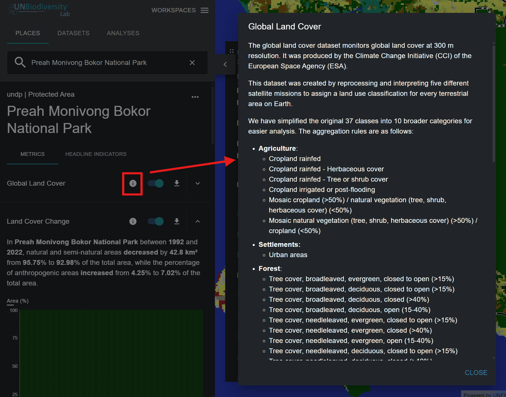
	
5.	To download summary data for the metric in .csv, .tsv, or .json format, click on the 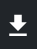{style="display: inline; width: 1em; height: 2em; width: 2em;"} icon. You can then choose whether to download summary data to your local directory in comma-separated value, table-separated value, or .json format. You can also download the data from source links in the layer info pages.  

	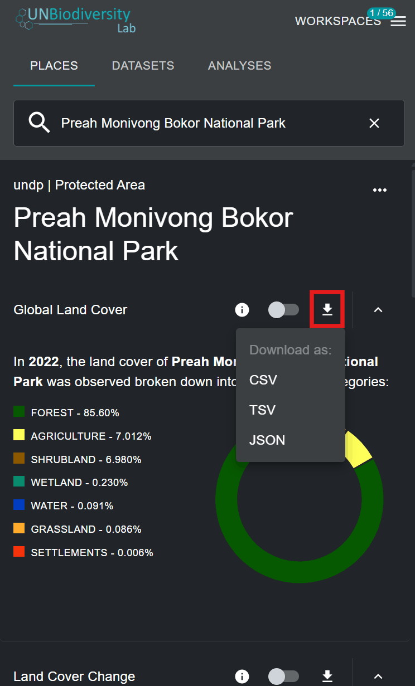
	

