# Adicionar as Suas Próprias Métricas Personalizadas ao Seu Espaço de Trabalho

**Esta tradução foi gerada por IA e pode conter erros.**

A plataforma pública do UNBL oferece atualmente onze métricas dinâmicas por defeito (consulte [«Que métricas dinâmicas estão disponíveis para o meu país?»](../unbl-public-platform/8_dynamic_metrics1.md)).

Os espaços de trabalho do UNBL dão aos utilizadores a capacidade de configurar as suas próprias métricas personalizadas para realizar cálculos em tempo real e exibir estatísticas zonais para as suas próprias áreas de interesse, derivadas das suas próprias camadas de dados geoespaciais carregadas.

A configuração de uma métrica personalizada num espaço de trabalho segue 5 etapas. Cada etapa é descrita, por sua vez, nesta secção.

## Etapa 1: Carregar um lugar

As métricas são exibidas no UNBL através da seleção de um lugar específico que define a área de interesse para a qual as estatísticas zonais são calculadas. Por isso, é necessário carregar para o seu espaço de trabalho o lugar para o qual deseja visualizar a métrica personalizada. Para obter os passos detalhados sobre como carregar um lugar para o seu espaço de trabalho, consulte [«Como adiciono lugares?»](5_add_places.md).

## Etapa 2: Carregar uma camada raster em formato GeoTIFF

Para criar uma métrica personalizada, é necessário carregar uma camada raster para a qual deseja visualizar estatísticas zonais. Os espaços de trabalho do UNBL apenas suportam cálculos de métricas com camadas carregadas no espaço de trabalho através da opção «GeoTIFF File Upload». Para obter os passos detalhados sobre como carregar uma camada com esta opção, consulte [«Como carrego camadas raster em formato GeoTIFF?»](6_add_data.pt.md#como-carrego-camadas-raster-em-formato-geotiff).

Para que uma métrica personalizada funcione corretamente no UNBL, é necessário ter em conta os seguintes pré-requisitos técnicos para as camadas GeoTIFF carregadas:

- Os GeoTIFF podem representar qualquer forma de dados contínuos ou categóricos, mas os valores de pixel devem ser do tipo inteiro ou float;

- Recomenda-se que, para dados categóricos, os GeoTIFF armazenem no máximo 25 classes inteiras discretas; um número maior de classes prejudica a legibilidade dos gráficos das métricas;

- As estatísticas zonais da sua métrica personalizada só podem ser calculadas para camadas GeoTIFF que tenham cobertura de dados no lugar que carregou. Se selecionar, na vista do mapa UNBL, um lugar cuja extensão espacial não se sobreponha de forma alguma à extensão espacial da camada GeoTIFF carregada para a qual configurou a métrica personalizada, a métrica devolverá um gráfico de dados vazio.

- É possível configurar uma métrica de série temporal que mostre alterações ao longo do tempo para várias camadas GeoTIFF; nesses casos, todas as camadas GeoTIFF devem ter os mesmos valores de atributos, como intervalos de valores mín./máx. para dados contínuos, ou definições de categorias (ou seja, a configuração da legenda) para dados categóricos.

Os utilizadores que desejem configurar métricas personalizadas para dados de polígonos vetoriais devem primeiro convertê-los para o formato raster GeoTIFF através de técnicas de rasterização. Podem encontrar-se exemplos de técnicas de rasterização na documentação online do [QGIS](https://docs.qgis.org/3.44/en/docs/user_manual/processing_algs/gdal/vectorconversion.html#rasterize-vector-to-raster), [PyGIS](https://pygis.io/docs/e_raster_rasterize.html) e [rdrr.io](https://rdrr.io/cran/terra/man/rasterize.html). Para minimizar os erros nos cálculos das métricas que podem ser introduzidos pelo processo de rasterização de dados vetoriais, considere:

- Se os dados vetoriais contiverem apenas nomes de atributos de texto, deve ser adicionado um novo campo inteiro antes da rasterização e atribuído um número único a cada classe, no caso de dados categóricos; esse campo inteiro deve ser usado para atribuir os valores de pixel durante a rasterização;

- Converter os dados vetoriais para um sistema de referência de coordenadas projetadas consistente, como WGS84 (EPSG: 4326), antes da rasterização;

- Os polígonos sobrepostos devem ser resolvidos através da prioridade de gravação de pixels durante a rasterização — por exemplo, abordagens de «último pintado» ou «ganha o valor mais alto»;

- Escolher uma resolução raster adequada que pondere o equilíbrio entre minimizar os erros de bordo na conversão dos limites dos polígonos em pixels e minimizar o tamanho do ficheiro (as camadas carregadas no seu espaço de trabalho UNBL através da opção «GeoTIFF File Upload» não podem ter mais de 1000 MB).

## Etapa 3: Criar uma métrica

Criar uma métrica implica escolher que camadas GeoTIFF do espaço de trabalho devem ser usadas para calcular as estatísticas zonais. Para criar uma métrica:

1.	Clique no botão «Home» na página de administração do seu espaço de trabalho para expandir o menu suspenso. Selecione «Metrics».

2.	Clique no botão «CREATE NEW METRIC» que aparece.

	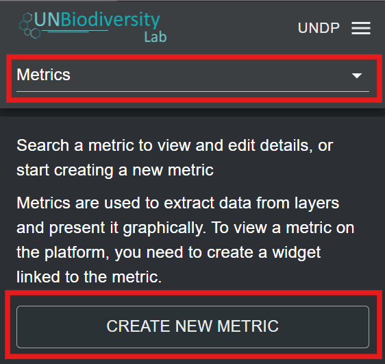

3.	Na página da nova métrica, preencha as seguintes informações:

	a) *Title*: O nome da sua métrica. Deve descrever o que mostra o conjunto de dados para o qual está a configurar a métrica. Pode ser o mesmo da camada GeoTIFF carregada para a qual está a configurar a métrica.

	b) *Metric slug*: Um slug é um identificador único para a métrica dentro do seu espaço de trabalho. Não pode ter várias métricas no seu espaço de trabalho com o mesmo slug. Deve conter apenas letras, dígitos e hífenes («-»). Pode usar o botão «GENERATE SLUG NAME» para gerar um identificador único com base no título da métrica fornecido.

	c) *Metric data source(s)*: Escolha uma camada GeoTIFF carregada no seu espaço de trabalho na lista suspensa. Para métricas personalizadas que mostram alterações ao longo do tempo, tem a opção de selecionar várias camadas GeoTIFF através do botão «ADD ADDITIONAL DATA SOURCE». Selecione esta opção apenas se tiver uma série de camadas GeoTIFF com um esquema de atributos consistente, como valores mín./máx. para dados contínuos, ou definições de categorias (ou seja, uma configuração de legenda) para dados categóricos.

	d) *Histogram bins*: Esta opção aparece como campo obrigatório se tiver selecionado uma camada GeoTIFF com uma categoria de dados contínuos. A métrica usará um histograma para calcular as estatísticas zonais das camadas de dados contínuos. Por isso, é necessário especificar o número de classes (bins) que o histograma calculado para a camada de dados contínuos terá. As classes são também conhecidas como intervalos. Dividem a gama de dados numéricos armazenados na camada GeoTIFF em grupos de largura igual. Escolha um número que crie um número adequado de intervalos de dados para a gama e a dispersão dos seus dados. Na maioria dos casos, entre 5 e 20 classes é o ideal, mas depende da gama de dados específica.

	e) *Calculate for place types (optional)*: Pode, opcionalmente, selecionar o tipo de lugar para o qual a sua métrica personalizada deve exibir estatísticas. Isto é útil, por exemplo, para uma métrica que mostra a eutrofização costeira e que abrange apenas lugares da categoria marinha. No entanto, se a camada de dados da métrica não tiver sido concebida para se limitar a uma área específica, este campo deve ser deixado vazio.

	f)	Depois de especificados todos os parâmetros, o botão «SAVE AND VIEW DETAILS» ficará azul, desde que todas as informações introduzidas sejam válidas. Clique neste botão para configurar a métrica no seu espaço de trabalho.

	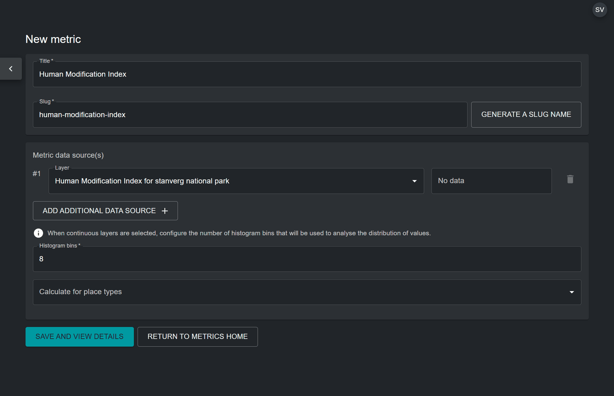

4. Na página de edição da métrica que aparece, ative o botão «Published» para publicar a métrica.

## Etapa 4: Criar um widget

Depois de configurada a métrica personalizada, é necessário criar um widget para essa métrica. O widget define a forma como os dados da métrica serão visualizados e que informações serão exibidas na vista do mapa UNBL. Para criar um widget:

1.	Clique no botão «Home» na página de administração do seu espaço de trabalho para expandir o menu suspenso. Selecione «Widgets».

2.	Clique no botão «CREATE NEW WIDGET» que aparece.

	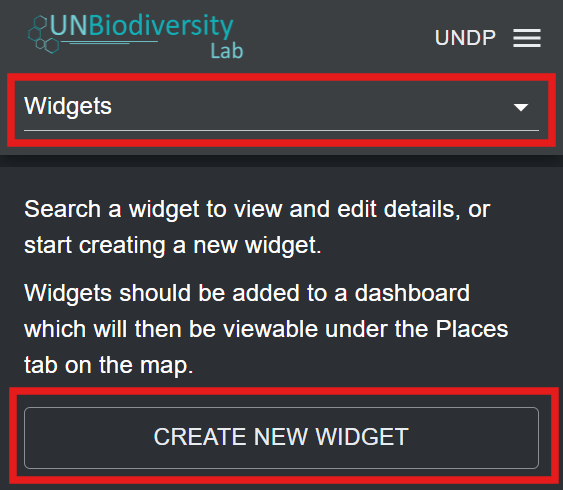

3. Na página do novo widget, preencha as seguintes informações:

	a) *Title*: Idealmente, o nome do widget deve ser igual ao nome da métrica configurada na Etapa 3. Assim, o widget fica claramente associado à sua métrica.

	b) *Widget slug*: Um slug é um identificador único para o widget dentro do seu espaço de trabalho. Deve conter apenas letras, dígitos e hífenes («-»). Pode usar o botão «GENERATE SLUG NAME» para gerar um identificador único com base no título fornecido. Idealmente, o slug do widget deve corresponder ao slug da métrica da Etapa 3.

	c) *Description (optional)*: Crie uma breve descrição para o seu widget. Deve ser uma descrição geral dos dados que a sua métrica mostra no UNBL. Este campo é opcional, pelo que não tem de ser preenchido.

	d) *Metric*: Escolha a métrica criada na Etapa 3 para a associar ao widget.

	e) *Widget Layer(s)*: Este campo especifica a camada de dados que pode ser visualizada na vista do mapa UNBL juntamente com a métrica. É preenchido automaticamente com a camada GeoTIFF associada à métrica escolhida. É possível escolher camadas adicionais no menu suspenso. No entanto, isto não é recomendado, a menos que existam no espaço de trabalho camadas adicionais que não são usadas para calcular a métrica, mas que são úteis para acrescentar informação geoespacial de contexto.

	f) *Widget Chart*: Determina o tipo de gráfico que será usado para visualizar as estatísticas da métrica para o seu lugar. A tabela abaixo resume os tipos de gráfico disponíveis em função do tipo de widget, que é detetado automaticamente com base em a) se a camada GeoTIFF mostra dados categóricos (classes discretas) ou dados contínuos (gama de valores numéricos), e b) se foi escolhida uma única camada ou várias camadas (métrica de série temporal) para a métrica.

	

	<table style="border-collapse: collapse;">
    <thead>
      <tr>
        <th style="min-width: 200px; border: 1px solid #ccc;"></th>
        <th style="text-align: center; font-size: 1.0rem; white-space: nowrap; border: 1px solid #ccc;"><strong>Dados contínuos</strong></th>
        <th style="text-align: center; font-size: 1.0rem; white-space: nowrap; border: 1px solid #ccc;"><strong>Dados categóricos</strong></th>
      </tr>
    </thead>
    <tbody>
      <tr>
        <td style="font-size: 1.0rem; border: 1px solid #ccc;"><strong>Camada única</strong></td>
        <td style="text-align: center; border: 1px solid #ccc;">Histograma 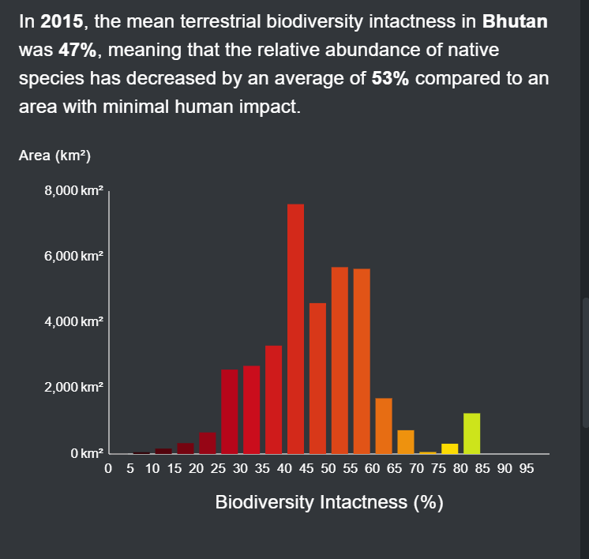{ width="350" style="display:inline-block"}</td>
        <td style="text-align: center; border: 1px solid #ccc;">Gráfico circular 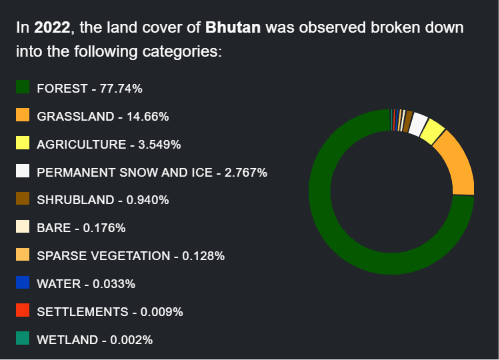{ width="250" style="display:inline-block"} Gráfico de barras 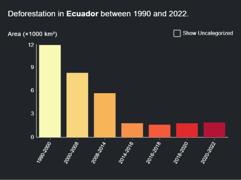{ width="250" style="display:inline-block"}</td>
      </tr>
      <tr>
        <td style="font-size: 1.0rem; border: 1px solid #ccc;"><strong>Série temporal</strong></td>
        <td style="text-align: center; border: 1px solid #ccc;">Gráfico de linhas 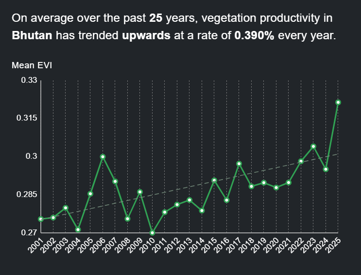{ width="250" style="display:inline-block"} Gráfico de área 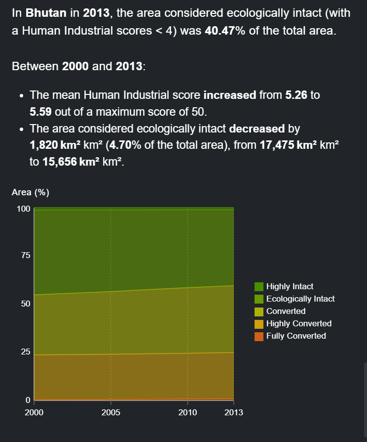{ width="250" style="display:inline-block"}</td>
        <td style="text-align: center; border: 1px solid #ccc;">Gráfico de área 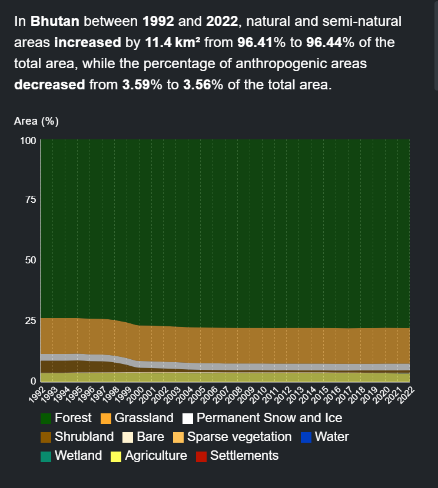{ width="350" style="display:inline-block"}</td>
      </tr>
    </tbody>
	</table>
	

	| Tipo de gráfico do widget | Apresentação dos dados |
	| :----------: | :----------: |
	| Histograma | Separa a gama numérica dos dados em intervalos de largura igual, chamados classes (bins). O número de classes apresentadas corresponde ao número de classes configurado na página da métrica no back-end. O eixo X apresenta a variável medida nos dados e o eixo Y apresenta a área medida, em km2, da área de interesse.
	| Gráfico de área | Para dados contínuos, também separa a gama numérica em classes, de acordo com o número de classes configurado na página da métrica no back-end. Para dados categóricos, são usadas as classes distintas. O eixo X apresenta o tempo e o eixo Y apresenta a percentagem da área total da área de interesse.
	| Gráfico circular | Mede a cobertura proporcional de cada classe categórica na área de interesse e apresenta as classes em setores que somam 100%.
	| Gráfico de barras | Apresenta cada classe categórica como uma barra, com o eixo X a apresentar os dados medidos e o eixo Y a apresentar a área medida, em km2, da área de interesse.
	| Gráfico de linhas | Representa a variação da média entre diferentes conjuntos de dados contínuos numa métrica de série temporal. O eixo X apresenta o tempo e o eixo Y apresenta o valor médio medido de cada conjunto de dados.

	f)i)	*Widget summary (optional)*: Cria um resumo das principais estatísticas da métrica, que será apresentado pelo widget. A lista de campos de resumo disponíveis fornece parâmetros que podem ser usados no texto do resumo. Abaixo apresenta-se um exemplo de resumo de widget para uma métrica de série temporal que usa três camadas com o Índice de Modificação Humana em três períodos.

	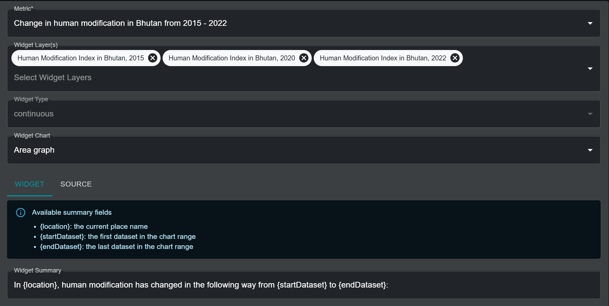

	Quando esta métrica e o widget associado estão ativos no UNBL, os campos de resumo no texto são preenchidos automaticamente com os parâmetros necessários, como se vê abaixo.

	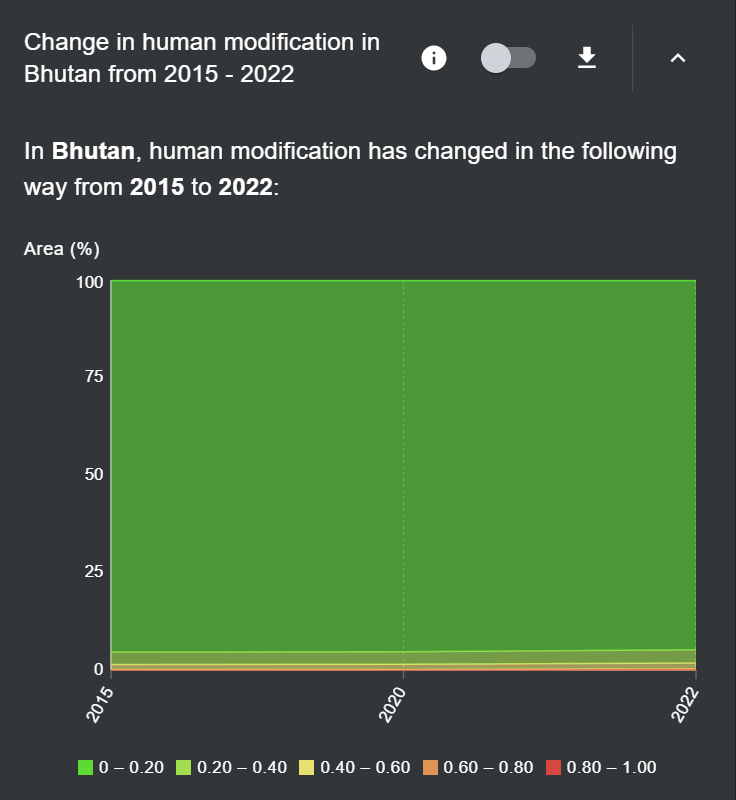{style="width:550px !important" }

	Em alternativa, o resumo do widget para uma métrica de camada única do Índice de Modificação Humana usaria os seguintes campos de resumo:

	- {location}: o nome do lugar atual
	- {areaKm2}: a área mapeada em quilómetros quadrados
	- {mean}: o valor médio como número bruto

	O resumo do widget seria, portanto, algo como:

		"In {location}, {areaKm2} square kilometers had a mean HMI score of {mean} in 2022."

	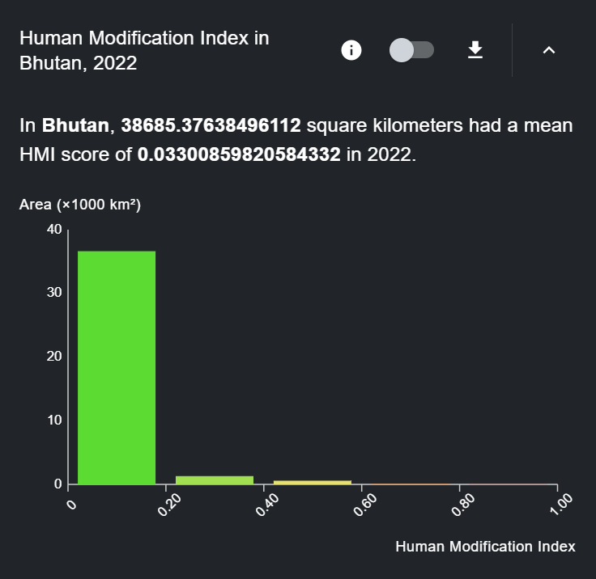{style="width:550px !important" }

	f)ii) Para métricas criadas com uma camada categórica, está disponível uma opção de alternância adicional chamada *Use layer categories*.

	A opção está ativada por defeito e especifica que o gráfico categórico do widget deve usar as mesmas categorias de camada configuradas na camada raster associada no UNBL. Caso os utilizadores pretendam usar no gráfico do widget categorias diferentes das especificadas na camada raster associada (por exemplo, para agregar as categorias da camada original num agrupamento de categorias simplificado), devem desativar a opção *Use layer categories*. Será então pedido ao utilizador que especifique uma lista exaustiva das categorias a usar no gráfico, sendo necessário preencher os seguintes parâmetros para cada categoria:

	- *Label*: O nome da categoria

	- *Colour*: Um seletor de cor para escolher a cor que deve ser usada para apresentar a categoria associada no gráfico do widget

	- *Values*: Número(s) único(s) na camada de dados subjacente que identificam a categoria configurada. O utilizador pode especificar mais de um número para a mesma categoria.

	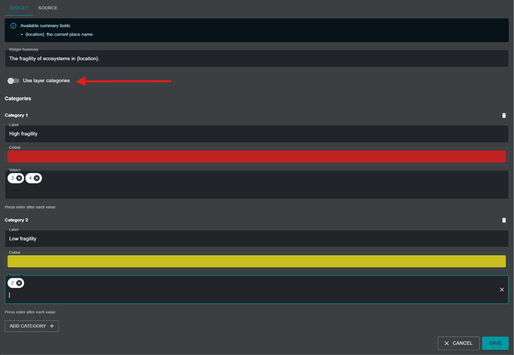

	g)	*X-Axis Label (optional)*: Para tipos de métricas com histograma, gráfico de linhas ou gráfico de área, é possível especificar um rótulo para o eixo X. O rótulo deve corresponder à variável de dados apresentada. Este campo é opcional, pelo que não tem de ser preenchido.

	h)	*X-Axis Unit (optional)*: Para tipos de métricas com histograma, gráfico de linhas ou gráfico de área, é possível especificar as unidades da variável de dados. Este campo é opcional, pelo que pode ser deixado em branco.

	i)	Depois de especificados todos os parâmetros, o botão «SAVE AND VIEW DETAILS» ficará azul, desde que todas as informações introduzidas sejam válidas. Clique neste botão para criar o widget.

	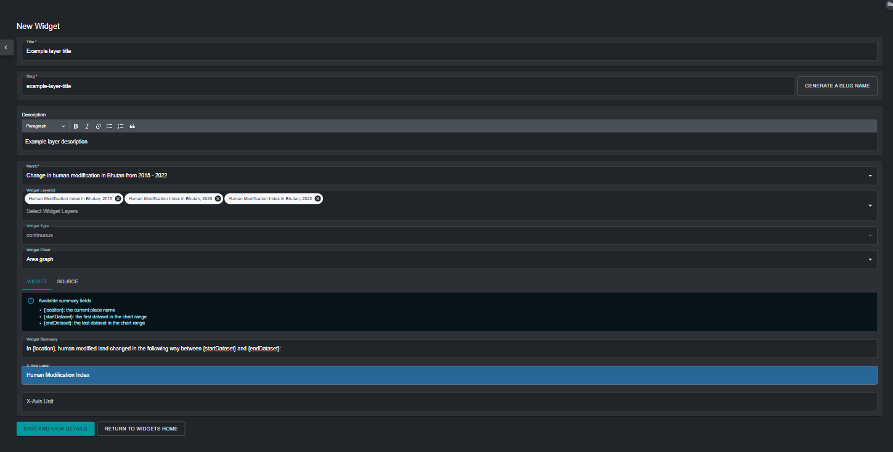

4. Na página de edição do widget que aparece, ative o botão «Published» para publicar o widget.

## Etapa 5: Criar um painel de controlo

Um painel de controlo funciona como a interface de utilizador que apresenta a métrica e o widget associado na vista do mapa UNBL quando se seleciona um lugar para visualizar métricas. É importante notar que os utilizadores podem criar tantas métricas e widgets quantos quiserem, mas todos podem ser colocados no mesmo painel de controlo. Por isso, basta criar um único painel de controlo para todas as métricas que um utilizador pretenda configurar. Se o seu espaço de trabalho ainda não tiver um painel de controlo, siga estes passos para criar um:

1.	Clique no botão «Home» na página de administração do seu espaço de trabalho para expandir o menu suspenso. Selecione «Dashboards».

2.	Clique no botão «CREATE NEW DASHBOARD» que aparece.

	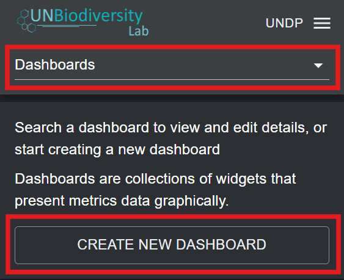

3. Na página do novo painel de controlo, preencha as seguintes informações:

	a)	*Title*: O painel de controlo deve ter um nome que defina claramente um grupo temático para as métricas personalizadas associadas a ele. Por exemplo, um painel de controlo pode conter todas as métricas personalizadas definidas por um determinado utilizador e, por isso, chamar-se «Custom metrics by *user x*». Em alternativa, um painel de controlo pode conter métricas destinadas a ser visualizadas para um lugar específico, por exemplo, «Custom metrics for *country x*».

	b)	*Dashboard slug*: Um slug é um identificador único para o painel de controlo dentro do seu espaço de trabalho. Não pode ter vários painéis de controlo no seu espaço de trabalho com o mesmo slug. Deve conter apenas letras, dígitos e hífenes («-»). Pode usar o botão «GENERATE SLUG NAME» para gerar um identificador único com base no título do painel de controlo fornecido.

	c)	*Dashboard description*: Pode fornecer aqui uma breve descrição do grupo de métricas. Por exemplo, «This dashboard contains custom metrics defined by *user x*.» Este campo é opcional, pelo que não tem de ser preenchido.

	d)	*Included Widgets*: Escolha o(s) widget(s) a incluir neste painel de controlo.

	e)	Depois de especificados todos os parâmetros, o botão «SAVE AND VIEW DETAILS» ficará azul, desde que todas as informações introduzidas sejam válidas. Clique neste botão para criar o painel de controlo.

	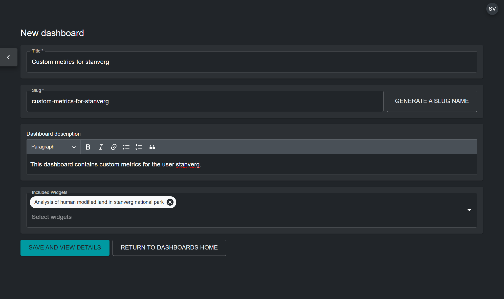

4. Na página de edição do painel de controlo que aparece, ative o botão «Published» para publicar o painel de controlo.

!!! note
	Se já tiver um painel de controlo e quiser adicionar-lhe widgets recém-configurados, pode editar o painel de controlo existente e adicionar widgets incluídos clicando no ícone de caneta do painel de controlo na lista de entradas de painéis de controlo que aparece na página de administração depois de escolher «Dashboards» no menu suspenso.

## Visualização de painéis de controlo e widgets

Para visualizar as suas métricas personalizadas:

1. Na vista do mapa UNBL, certifique-se de que o seu espaço de trabalho está ativado.

	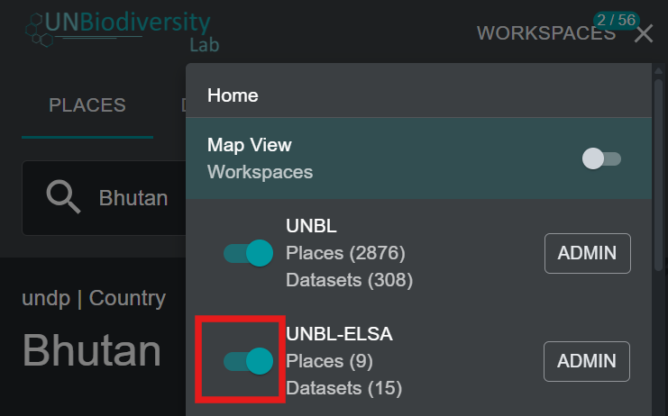{style="width:600px !important" }

2. Selecione, no separador «PLACES», o lugar para o qual deseja visualizar as métricas personalizadas.

	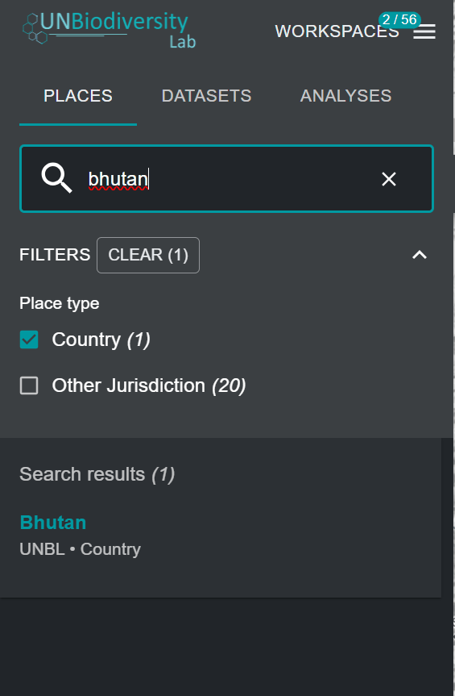{style="width:400px !important" }

3. Se tiver a plataforma pública do UNBL e/ou outros espaços de trabalho ativos juntamente com o seu próprio espaço de trabalho, poderá ter de selecionar o painel de controlo que contém as suas métricas personalizadas para as visualizar. Nesse caso, aparecerá um menu suspenso com uma lista de painéis de controlo e os espaços de trabalho associados a cada um. Selecione o seu painel de controlo no menu suspenso.

	!!! note
		Se as métricas personalizadas do seu painel de controlo não se sobrepuserem ao lugar ativado, o seu painel de controlo não aparecerá no menu suspenso.

	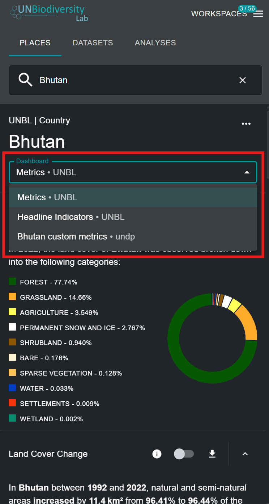{style="width:400px !important" }

4. Pode agora visualizar as métricas personalizadas que configurou para a camada GeoTIFF e o lugar escolhidos. Todas as funcionalidades das métricas dinâmicas padrão do UNBL estão disponíveis para as suas métricas personalizadas, incluindo ativar a camada associada, ver informações e descarregar os dados das métricas nos formatos .csv, .tsv e .json.

	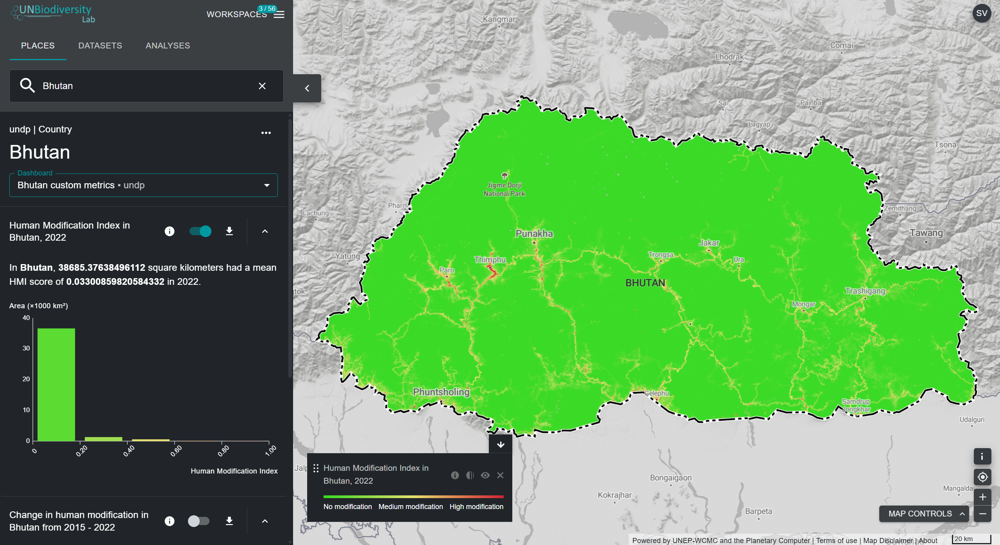

	!!! note
		**As métricas personalizadas só são calculadas quando as solicita.** Da primeira vez que uma métrica personalizada é mostrada para um lugar, o respetivo widget indica *This metric has not been calculated for this place yet.* Clique no botão **Calculate metric** para iniciar o cálculo. Enquanto decorre, o widget mostra *Calculating metric...* com uma barra de progresso. Se o cálculo falhar, o widget mostra *Metric calculation failed*; se não for possível enviar o pedido, aparece *Something went wrong* junto ao botão e pode tentar novamente. As métricas dinâmicas padrão da plataforma pública do UNBL não são afetadas e são calculadas automaticamente.
